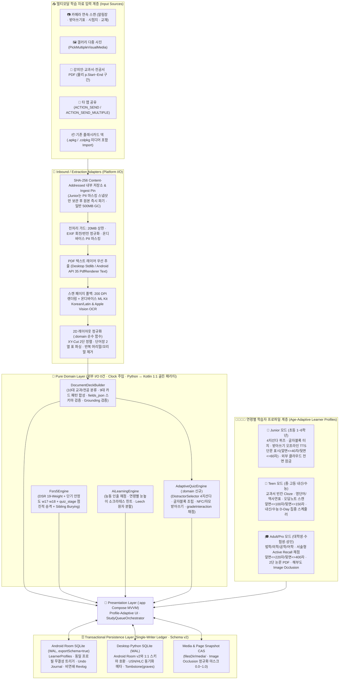

# 🏛️ BrainDeck (브레인덱 · 구 BrainDeck 2.0) — 전 연령(초등~성인) · Apple 오프라인 웹앱(PWA) & 네이티브 Android · 인앱 브레인팩 스토어(`₩990~₩1,900`) 마스터 설계도 (`v4.0 Final`)

- **문서 번호**: `BRAINDECK-BLUEPRINT-2026-10-21` (**v4.0 Final All-Ages + Apple Standalone PWA & Android + In-App BrainPack Store (`₩990~₩1,900`) + UI/UX Master Edition**)
- **프로젝트 경로**: `/Users/choyoungseo/Documents/개발/BrainDeck` (하위호환 심볼릭 경로: `/Users/choyoungseo/Documents/개발/BrainDeck` · `src/braindeck` + `android-app/`)
- **연계 UI/UX 설계 정본**: [`docs/UI_UX_DESIGN_BLUEPRINT.md`](./UI_UX_DESIGN_BLUEPRINT.md)
- **아키텍처 표준**: Clean / Hexagonal Architecture + MVVM + State Machine + 2-Tier DB (Tier R Reference Pack + Tier U User Ledger) + 2-Tier Offline Web Vault (`IndexedDB/OPFS` + `localStorage`) + ATDD/BDD/TDD/DDT
- **설계 목적**: **초등학교 저학년부터 중고등 수험생, 대학생·성인 전문가까지 모두 사용할 수 있는 범용 AI 암기·학습 플랫폼 `BrainDeck(브레인덱)`**을 **Apple(iPhone·iPad·Mac) 오프라인 내장형 웹앱(PWA)과 네이티브 Android 앱(`android-app/`)**으로 동시 구축하고, **본인 자료(사진/PDF) 직접 업로드 무제한 무료(`₩0`) + 인앱 『브레인팩 스토어(BrainPack Store)』 초소액(`₩990 ~ ₩1,900`) 마스터 데이터팩 영구 장착 모델**을 탑재하면서 구현 후 재작업(삽질)을 유발하는 **34대 아키텍처 함정(T1~T34)**을 사전 차단한다.

---

## 1. 시스템 전체 아키텍처 토폴로지 (All-Ages Clean / Hexagonal + Multi-Platform Parity)



---

## 2. 초등학생 ~ 성인 전 연령 대응 `ProfilePolicy` & `gradeInteraction` 결정론적 계약

코드 곳곳에 `if (age == "junior")` 분기를 두지 않고, 순수 함수 `resolveProfilePolicy(ageTier, profileOverrides, deckOverrides) -> ProfilePolicy`가 반환하는 **데이터 정책 객체(`ProfilePolicy`)**와 **단일 결정론적 채점 변환기(`gradeInteraction(InteractionResult, ProfilePolicy) -> GradeDecision`)**로 전 연령을 일관되게 처리합니다.

### 2.1 설정 우선순위 및 정본 텍스트 불변 계약 (Canonical vs Display Variants)
1. **설정 적용 우선순위 (Override Precedence)**:
   - **`Deck 명시적 설정 > LearnerProfile 사용자 설정 > AgeTier ProfilePolicy 기본값`** 순으로 적용합니다.
   - 단, **아동 보호 하드락(`junior`의 외부 클라우드 전송 차단 `cloud_vision_locked = 1`, `Easy(4)` 평점 차단)**은 상위 덱 설정으로도 해제할 수 없는 **불변 안전 게이트(Safety Invariant)**입니다.
2. **정본 텍스트(`notes.front/back`)와 연령별 표시 변형(`fields_json.display_variants`) 분리**:
   - `notes.front`와 `notes.back`에는 항상 **원문에서 추출·검증된 정본(Canonical) 텍스트**를 저장합니다.
   - 연령별 축약 질문이나 눈높이 해설은 `fields_json.display_variants` (`{"junior": {"front": "...", "back": "...", "explanation": "..."}, "teen": {...}, "adult": {...}}`)에 저장하며, 렌더링 시 **`display_variants[active_age_tier] ➔ 정본 notes.front/back`** 순으로 폴백합니다.
   - 모든 연령별 변형(`display_variants`)의 정답 토큰과 수치도 정본과 동일하게 `groundCards` 원문 대조 게이트를 통과해야 하며, **학습자가 초등(`junior`)에서 중고등(`teen`)·성인(`adult`)으로 프로필 등급을 올려도 기존 `notes.id`, `cards.id`, FSRS 기억 상태(`stability, difficulty, reps, lapses`)는 100% 그대로 유지**됩니다.

| 정책 항목 (`ProfilePolicy`) | 🌱 **Junior (초등 1~6학년)** | 🚀 **Teen (중·고등 내신/수능)** | 🎓 **Adult / Pro (대학생·수험·성인)** |
| :--- | :--- | :--- | :--- |
| **주요 입력 자료** | 받아쓰기 급수표, 초등 영단어장, 사회/과학 교과서, 단원평가 오답 시험지 | 중·고등 영어 본문/단어장, 국어 문법/문학, 역사 연표, 수학/과학 공식, 모의고사 오답 | 전공서·논문 PDF(2단), 법학 조문/판례, 의학 해부도, 공학 핸드북, 어학 회화, 자격증 기출 |
| **질문 / 정답 글자 수 게이트** | 앞면 **최대 40자**(권장 15~40자) / 뒷면 **최대 60자** (초과 시 문장 분할 또는 확인 대기열로 Fail-Closed) | 앞면 **최대 100자**(권장 30~100자) / 뒷면 **최대 150자** | 앞면 **최대 220자**(권장 50~220자) / 뒷면 **최대 400자** (조문·수식 원문 보존) |
| **일일 기본 상한 & 목표 기억률** | 신규 **10장** / 복습 **50장**, 목표 기억률 **`0.85`**, 정상 응답 기준시간 **`normalLatencyMs = 12,000ms`** | 신규 **20장** / 복습 **150장**, 목표 기억률 **`0.90`**, 정상 응답 기준시간 **`normalLatencyMs = 10,000ms`** | 신규 **25장** / 복습 **150장**, 목표 기억률 **`0.90`**, 정상 응답 기준시간 **`normalLatencyMs = 8,000ms`** |
| **허용 퀴즈 & 인출 방식** | `button_2`(`알아요/모르겠어요`), `multiple_choice`(4지선다), `tap_block`(글자블록), `dictation`(받아쓰기), `image_occlusion` *(자기평가 `Easy(4)` 전역 비활성화)* | 전체 모드 허용 (`multiple_choice`, `tap_block`, `dictation`, `cloze`, `free_recall`, `speaking`, `image_occlusion`, `button_4`) | 전체 모드 허용 (기본 `quiz_stage = 2` 직접 인출 우선: `free_recall`, `speaking`, `cloze`, `image_occlusion`, `button_4`) |
| **단계 승격 (`quiz_stage` Scaffolding)** | 카드별 `quiz_stage` (`0:RECOGNITION_MC ➔ 1:TAP_BLOCK ➔ 2:RECALL_INPUT`) 및 `consecutive_successes` 컬럼 운영:<br>• **승격 조건**: 첫 시도 성공(`rating >= 2`) 시 `consecutive_successes += 1`. **`stability >= 3.0` 이고 `consecutive_successes >= 2`** 달성 시 다음 복습부터 `quiz_stage = min(2, quiz_stage + 1)`로 승격 후 `consecutive_successes = 0` 리셋<br>• **강등 조건**: `AGAIN(1)` 발생 시 `consecutive_successes = 0` 리셋 및 `quiz_stage = max(0, quiz_stage - 1)`로 1단계 하향 | 좌동하되 **승격 기준 안정도 `stability >= 5.0` 이고 `consecutive_successes >= 2`** 달성 시 `quiz_stage` 승격 (`AGAIN(1)` 시 1단계 하향) | 기본 `quiz_stage = 2 (RECALL_INPUT)` 시작 (단, 거머리 카드나 사용자 선택 시 `0` 또는 `1` 단계 보조 사용 가능) |
| **아동 개인정보 & 하드락 안전 가드** | • 생년월일 미저장(`age_tier`만 저장)<br>• **외부 클라우드 비전/LLM/온라인 TTS·STT/공개 덱 공유 전면 하드락 OFF (`cloud_vision_locked = 1` DB CHECK 강제)**<br>• **수집 시 학교·학년·반·이름 PII 온디바이스 마스킹 후 원본 파일 즉시 파기(`local_cas_path = NULL`)** | 기본 온디바이스 처리 + 학생 실명/학번 정규식 마스킹 | 온디바이스 우선 + 선택적 외부 AI 연동 |

### 2.2 `gradeInteraction(InteractionResult, ProfilePolicy) -> Rating(1~4)` 결정론적 채점 명세
1. **첫 시도 전용 원칙 (First-Attempt-Only Rule)**:
   - 한 카드의 출제 턴에서 **첫 번째 제출(`attempt_count == 1`, `firstAttempt = true`)만 FSRS 평점(`1~4`) 및 `revlog` 스케줄링에 반영**됩니다. 오답 후 정답을 맞히기 위해 수행하는 동일 턴 내 재시도는 학습 피드백용일 뿐 FSRS 등급을 절대 상향하지 않습니다.
   - 응답 지연(`responseMs > policy.normalLatencyMs`)은 등급을 **1단계 하향(`4 ➔ 3` 또는 `3 ➔ 2`)만 할 수 있으며, 어떤 경우에도 등급을 상향하지 않습니다.**
2. **인터랙션 모드별 평점 변환 규칙**:
   - **`button_2` (2버튼 `알아요 / 모르겠어요`) [`evidence_class = 'recognition'`]**:
     - `모르겠어요` ➔ **`1 (Again)`**
     - `알아요` ➔ **`2 (Hard)`** *(검증 없는 2버튼 자기보고는 재인 수준이므로 `3(Good)`·`4(Easy)` 부여 금지)*
   - **`button_4` (4버튼 자기평가 `Again(1) / Hard(2) / Good(3) / Easy(4)`) [`evidence_class = 'recall'`]**:
     - 허용 대상: `Teen` 및 `Adult` 전용 (`Junior` 프로필에서는 비활성화되며 호출 시 Fail-Closed 거부)
     - 기본 평점: 사용자가 선택한 버튼 값(`selectedRating IN (1, 2, 3, 4)`)을 그대로 사용하되, **힌트를 사용한 경우(`hintUsed == true`) `4 (Easy)` 선택 시 `3 (Good)`으로 상한 클램프(`min(selectedRating, 3)`)**합니다. (명시적 4버튼 자기평가에서는 응답 시간 `responseMs`에 의한 강제 하향을 적용하지 않음)
   - **`multiple_choice` (객관식 선택) [`evidence_class = 'recognition'`]**:
     - 오답 선택 (`!isCorrect`) ➔ **`1 (Again)`**
     - 정답 선택 & `optionCount <= 3` (2~3지선다/OX) ➔ **`2 (Hard)` 상한 고정**
     - 정답 선택 & `optionCount >= 4` & (`hintUsed` 또는 `responseMs > policy.normalLatencyMs`) ➔ **`2 (Hard)`**
     - 정답 선택 & `optionCount >= 4` & `!hintUsed` & `responseMs <= policy.normalLatencyMs` ➔ **`3 (Good)`** *(객관식은 전 연령 `4(Easy)` 원천 차단)*
   - **`tap_block` (글자/단어 블록 터치 조립) [`evidence_class = 'cued_recall'`]**:
     - 최종 제출 전 블록 취소/교체 횟수를 `blockCorrections`로 계측:
     - 오답 제출 또는 `blockCorrections >= 2` ➔ **`1 (Again)`**
     - 정답 제출 & (`blockCorrections == 1` 또는 `hintUsed` 또는 `responseMs > policy.normalLatencyMs`) ➔ **`2 (Hard)`**
     - 정답 제출 & `blockCorrections == 0` & `!hintUsed` & `responseMs <= policy.normalLatencyMs` ➔ **`3 (Good)`** *(`4(Easy)` 차단)*
   - **`dictation` (TTS 받아쓰기 / 스펠링) [`evidence_class = 'recall'`]**:
     - 비교 전 **Unicode `NFC` 정규화** 및 **한글 초·중·종성 자모 분해 편집거리(`jamoEditDistance`)** 계산 (`fields_json.spacing_strict == true`이면 공백 불일치도 거리 `+1` 가산):
     - 받아쓰기 문장(`pattern == 'dictation_sentence'`): `jamoEditDistance == 0`이면 **`3 (Good)`** (`hintUsed` 또는 지연 시 **`2 (Hard)`**), `jamoEditDistance >= 1`이면 **`1 (Again)`**.
     - 일반 어휘 스펠링(`pattern == 'vocab_table'`): `jamoEditDistance == 0`이면 **`3 (Good)`**, `jamoEditDistance == 1`(단순 자모 오타 1자)이면 **`2 (Hard)`**, `jamoEditDistance >= 2`이면 **`1 (Again)`**.
   - **`free_recall` / `speaking` / `cloze` / `image_occlusion` (주관식 능동 인출) [`evidence_class = 'recall'`]**:
     - `evaluateFreeRecall` 종합 점수 `score = 0.65 * tokenOverlap + 0.35 * charBigram`:
     - 핵심 수치/단위 불일치(`!numericMatch`) 또는 부정어 충돌(`negationConflict == true`) 또는 `score < 45.0` ➔ **`1 (Again)`**
     - `45.0 <= score < 74.0` ➔ **`2 (Hard)`**
     - `74.0 <= score < 92.0` (또는 `score >= 92.0`이나 `hintUsed` / 응답 지연 / `age_tier == 'junior'`인 경우) ➔ **`3 (Good)`**
     - `score >= 92.0` & `!hintUsed` & `responseMs <= policy.normalLatencyMs` & `age_tier IN ('teen', 'adult')` ➔ **`4 (Easy)`**

---

## 3. 구현 후 '삽질(재작업)'을 유발하는 34대 아키텍처 함정과 선제 방어 설계 (T1 ~ T34)

기존 15대 기술 함정(T1~T15), 4대 전 연령 교육공학 함정(T16~T19), 7대 내장 레퍼런스 DB 함정(T20~T26), 2대 중·고등 교과서 시험범위 함정(T27~T28)에 더해, **Apple(iOS/iPadOS/macOS) 오프라인 내장형 웹앱(PWA) + Android 동시 운영 및 인앱 『브레인팩 스토어(`₩990~₩1,900`)』 상용화 시 발생하는 6대 크로스플랫폼·결제·스토리지 함정(T29~T34)**을 추가 방어합니다.

| # | 재작업 위험 포인트 (Trap) | 현재 상태 및 위험 진단 | 선제 방어 설계 (Blueprint v4.0 Final Solution) |
| :-: | :--- | :--- | :--- |
| **T1** | **Room 마이그레이션 불가 및 스키마 확장성 부재** | `version = 1, exportSchema = false`, 노트가 `front/back` 고정 컬럼 | `exportSchema = true`, `room.schemaLocation` 지정, `MigrationTestHelper` 의무화, v1→v2 마이그레이션 시 기본 프로필(`profile_id = 1`) 및 `subject_taxonomy` 선행 시드 후 전 테이블 확장 |
| **T2** | **카드 삭제 시 `revlog` 연쇄 삭제로 통계·FSRS 표본 증발** | `RevlogEntity`의 `onDelete = CASCADE`로 카드 삭제 시 과거 복습 기록도 삭제됨 | `revlog`에서 `CASCADE` 외래키를 제거하고 `profile_id`를 비연쇄 보존하여 카드가 삭제/분할되더라도 프로필별 장기 기억 데이터 영구 보존 |
| **T3** | **그룹 Undo 불가 · 편집 충돌 · 동기화 부활 버그** | 직전 상태 일부만 저장하며 형제 카드 Bury 복원 및 동기화 부활 방지 없음 | `undo_journal`에 변경 전 카드 스냅샷(`before_card_json`, `quiz_stage` 및 `consecutive_successes` 포함)과 최종 `after_modified_at_epoch_ms`를 기록, 불일치 시 Undo 차단, Undo 시 `graves`에 tombstone 기록 |
| **T4** | **신규 카드(`new`)에서 `Again` 선택 시 `lapses`가 증가하는 FSRS 버그** | `isNew && AGAIN`에서 `lapses += 1`이 되어 신규 카드를 2번 틀리면 Leech로 오판 | `lapses`는 오직 **`state == "review"`에서 `AGAIN`을 누른 경우에만 `+1` 증가**하도록 수정. 단기 안정도(`w17, w18`) 및 간격 Fuzz 반영 |
| **T5** | **하루 경계 시각(Day Rollover) 부재 및 큐(`queue`) 코드 불일치** | `dueEpochSec <= now` 하나로 모든 카드를 섞어 가져옴 | 새벽 4시(`rollover_hour = 4`) 기준 학습일(`studyDay`) 도입 및 7-State `queue`(`0:NEW, 1:INTRADAY, 2:REVIEW, 3:INTERDAY, -1:SUSPENDED, -2:USER_BURIED, -3:SIBLING_BURIED`) 전 계층 통일 |
| **T6** | **동일 문장 다중 빈칸(`c1`, `c2`) 및 역방향 카드 당일 스포일러** | 같은 노트의 카드들이 같은 날 연달아 출제되어 정답 노출 | **Sibling Burying (`queue = -3`, `buried_until_study_day = today + 1`)** 자동 적용 |
| **T7** | **모바일 카메라 촬영본 EXIF 회전 무시로 인한 한글 OCR 붕괴** | `BitmapFactory`가 EXIF 회전을 무시해 세로 사진이 90° 누운 채 OCR됨 | `ExifInterface` 회전/반전 정규화를 거친 정방향 비트맵만 OCR 및 Image Occlusion(0.0~1.0)에 사용 |
| **T8** | **2단(Two-Column) PDF 줄 섞임 및 디지털 PDF 무조건 OCR 병목** | 2단 문서 좌우 줄이 섞이며 디지털 PDF도 200 DPI OCR을 돌려 느림 | PDF 텍스트 레이어 우선 추출 + 실패 페이지만 200 DPI OCR 폴백 + `:domain` 순수 **2D XY-Cut 다단 정렬기** 탑재 |
| **T9** | **페이지 구간(`p.Start~End`) 선택 시 물리 페이지 번호 혼동** | `101~150쪽` 수집 시 `source_page`가 `1..50` 상대 번호로 저장될 위험 | `source_page`는 항상 **원본 PDF의 1-based 물리 페이지 번호(`101..150`)**로 고정하고 인쇄 쪽번호는 `page_label`로 분리 |
| **T10** | **프리뷰 취소 시 CAS 임시 파일 누수 및 대형 PDF 용량 폭발** | 프리뷰 취소 시 고아 파일이 남고 원본 PDF가 쌓여 용량 부족 유발 | `ingest_pins` 임시 핀 + 카드 참조 페이지 **WebP 경량 스냅샷(`~80KB/쪽`)** 보관 + 일반 프로필 원본 PDF 500MB LRU GC (`junior`는 추출 직후 원본 즉시 파기) |
| **T11** | **문서 개정/문구 수정 시 `guid` 변경으로 `UPDATED` 매칭 실패** | `guid`에 전체 앞면이 들어가 오타만 고쳐도 신규 카드로 중복 생성됨 | `semantic_guid`(노트 정체성)와 `content_hash = sha256(normalizedFront \|\| "\0" \|\| normalizedBack \|\| "\0" \|\| canonicalFieldsJson)` 분리 |
| **T12** | **희소 Cloze 번호(`c1, c3`) 및 빈칸 수정 시 자식 카드 고아/누락** | `1..k` 연속 가정 시 `c1, c3` 오작동 및 삭제된 `ord` 학습 이력 증발 | `distinctOrdinals(front)` 사용 + 유지된 `ord`는 FSRS 보존, 추가된 `ord`는 신규 생성, 제거된 `ord`는 `reps > 0`이면 `queue = -1(SUSPENDED)`로 보호 |
| **T13** | **Filtered / Cram 덱 사용 시 `deck_id` 직접 변경으로 인한 원복 실패** | 임시 덱 이동 중 강제 종료 시 원래 소속 덱 유실 | `cards.deck_id` 불변 유지 + `study_sessions(reschedule_enabled)` & `study_session_items` 가상 세션 테이블로 비파괴 운영 |
| **T14** | **백그라운드 프로세스 종료 시 대용량 OCR 작업 증발** | `viewModelScope` 코루틴이 앱 전환 시 종료됨 | `WorkManager` Foreground 체크포인트로 마지막 완료 페이지부터 이어서 수집 |
| **T15** | **Desktop(Python) ↔ Android(Kotlin) 도메인 이중 구현 괴리** | Python에만 AI 채점/힌트/Leech 분할이 있음 | `:domain`에 `AiLearningEngine.kt` & `AdaptiveQuizEngine.kt` 1:1 이식 및 공용 JSON 골든 벡터 검증 |
| **T16** | **[전 연령] 재인(객관식) vs 회상(주관식) 점수 오염으로 인한 FSRS 안정도($S$) 뻥튀기** | 4지선다 보기를 보고 맞힌 것(재인)을 자유 회상과 똑같이 취급하거나 FSRS 가중치 최적화에 섞으면 복습 간격이 비정상적으로 길어져 대량 망각 발생 | **첫 시도 전용 채점 + 선택지 수(`optionCount`)별 등급 상한 + `evidence_class` 분리**:<br>① 첫 번째 제출(`attempt_count == 1`)만 FSRS 평점에 반영<br>② `button_2` 및 `optionCount <= 3` 객관식은 최대 `HARD(2)`, 4지선다는 최대 `GOOD(3)` 상한 고정(`EASY(4)` 원천 차단)<br>③ `revlog.evidence_class` (`'recognition' \| 'cued_recall' \| 'recall'`)를 기록하여 FSRS 최적화기(`w0~w18`)는 `evidence_class = 'recall'`(최소 1,000건)만 학습하며, 대시보드도 **'재인 익힘'**과 **'회상 익힘'**을 분리 표시 |
| **T17** | **[전 연령] 4지선다 오답 보기(Distractor)를 통한 정답 유출 & 카드 수 부족(Cold-Start)** | 같은 노트의 역방향 짝 카드가 오답 보기로 나오거나 정답과 동일한 보기/중복 보기가 생성되며, 덱에 카드가 4장 미만일 때 4지선다 생성이 깨짐 | **`:domain` 순수 `DistractorSelector` 5단계 후보 탐색 & 정답 집합 비중첩(`Answer-Set Non-Overlap`) 필터 & 결정론적 Cold-Start 폴백**:<br>① **후보 탐색 순서**: `wrong_answer_note`의 `student_wrong_answer` ➔ **내장 레퍼런스 팩(`Tier R`)의 `ref_relations` 과목별 함정 관계(유효기간 통과 엔트리 한정)** ➔ 같은 덱의 타 노트(`note_id != current.note_id`, 형제/역방향 카드 제외) ➔ 동일 `profile_id`·동일 `category` 타 덱 카드 ➔ 순수 수치(비연도) 근접 변형기 및 시드 은행<br>② **Anti-Leak & 정답 집합 비중첩 필터**: 모든 후보는 `targetAnswerSet ∩ candidateAnswerSet == ∅` (예: 한자 음 질문 시 목표 한자의 모든 독음 집합과 후보 한자의 독음 집합이 1개도 겹치지 않아야 함), 금지 관계 우선 배제(`Forbidden Wins`), 동의어 제외, 표시 텍스트(`normalizedOptionText`) 중복 제거를 통과해야 함<br>③ **Cold-Start 폴백**: 판정 불능이거나 유효 오답이 **3개 미만(`< 3`)**이면 즉시 **`tap_block`(글자블록 조립) ➔ `button_2`(2버튼 모드)** 순으로 폴백 |
| **T18** | **[전 연령] 학교 유인물(받아쓰기 급수표, 단어장 표, 단원평가 오답노트) 및 한글 NFC/NFD 인코딩 불일치** | macOS/iOS의 한글 NFD와 Android NFC가 달라 받아쓰기 채점이 틀리거나, 초·중·고 학교 프린트물 특유 양식이 추출되지 않음 | **한글 NFC 정규화(단, CJK 호환 한자는 코드포인트 선행 보존) + 자모 단위 편집거리 + 12대 카드 패턴(`fields_json` 버전 스키마) 확장**:<br>① 받아쓰기/스펠링 비교 전 한글 초·중·종성 자모 분해 편집거리 적용<br>② 12대 패턴별 엄격한 `fields_json` 스키마(`schema_version: 1`) 검증 및 불일치 시 Fail-Closed(`invalid_fields_schema`) |
| **T19** | **[전 연령] 아동 개인정보(학교·반·이름) 노출 및 가족 공용 기기 프로필 데이터 혼선** | 초등학생 시험지/알림장 상단의 `OO초등학교 3학년 2반 홍길동` 텍스트가 카드나 원본 캐시에 남거나, 부모와 자녀의 덱/세션이 섞임 | **수집 즉시 온디바이스 PII 마스킹 & 원본 파기 + `junior` 하드락 + 프로필 간 교차 참조 차단 트리거**:<br>① `junior` 프로필은 DB `CHECK (age_tier != 'junior' OR cloud_vision_locked = 1)`로 외부 클라우드 비전/LLM/온라인 STT·TTS/공개 공유를 원천 차단<br>② `junior` 문서 수집 시 **저장 전** 이미지 내 학교·학년·반·이름 영역 마스킹 스냅샷만 생성하고 원본 파일은 즉시 삭제(`local_cas_path = NULL`)<br>③ `decks`, `notes`, `cards`, `study_sessions`, `pack_activations` 전 경로에 **동일 `profile_id` 무결성 트리거(`cross_profile_violation`)** 강제 |
| **T20** | **[내장 DB 신규] 수만 건의 기본 시험/어학/한자 데이터를 사용자 원장 DB(`cards`)에 일괄 복사할 때 발생하는 DB 비대화 & 패치 불가** | 한자·영단어·한국사·법령 5만 건을 첫 실행 시 `notes`/`cards`에 미리 INSERT하면 프로필마다 DB가 수십 MB로 불어나고 백업이 폭증하며, 공식 팩 오타 수정 시 사용자 FSRS 상태를 깨뜨림 | **2-Tier DB 분리(`Tier R: 읽기 전용 팩 SQLite` vs `Tier U: 사용자 원장 DB`) + Append-Only Ordinal 지연 생성**:<br>① `ref_collections.ordinal`은 버전 간 **Append-Only 불변 계약**을 따르며(기존 항목의 `ordinal` 재정렬·중간 삽입 금지, 신규 항목은 `max(ordinal)+1`에 추가, 은퇴 항목은 자리 유지 채 `retired=1` 마킹), `pack_activations`는 `resolved_pack_version`과 `next_ordinal`을 보유<br>② 일일 신규 카드 도입 시점에만 `ordinal >= next_ordinal`이면서 미생성(`NOT EXISTS` in `notes`)이고 시간 유효성(`retired=0, disputed=0, valid_from/until`)을 만족하는 항목을 조회하여 **`notes/cards INSERT + next_ordinal 전진 + 일일 신규 할당량 차감`을 단일 `BEGIN IMMEDIATE` 트랜잭션으로 원자 실행**<br>③ 팩 업데이트 시 `ref_changelog.change_kind` 규칙(`cosmetic/errata`는 FSRS 유지, `answer_changed`는 배지 표시 후 `quiz_stage` 1단계 하향, `retired=1`은 미학습 카드(`reps=0`)면 정리·기학습 카드(`reps>0`)면 `queue=-1(SUSPENDED)`) 및 `user_override_json` 보호 적용 |
| **T21** | **[내장 DB 신규] 기출문제/급수 배정표 저작권 침해 및 CC BY-SA 라이선스 오염** | 사설 단어장·한자 급수 배정표(편집저작물)·기출문제 원문을 무단 내장하거나, CC BY-SA 데이터를 독점 팩과 한 DB에 섞으면 법적 분쟁 및 라이선스 오염 발생. 또한 JLPT·TOEIC 등은 공식 단어장이 없음 | **라이선스 허용목록(`license_class`) 빌드 게이트 + 팩 파일 물리 격리 + 비공식/추정 레벨 정직 표기**:<br>① `ref_sources.license_class` 허용 목록(`PUBLIC_LAW_ART7`, `KOGL_1`, `CC0`, `CC_BY`, `CC_BY_SA`, `FACT_SELF_AUTHORED`, `SYNTH_REVIEWED`, `CONTRACT_LICENSED`) 외(`NC/ND/KOGL_2~4/UNKNOWN`) 1건이라도 포함 시 **팩 빌드 즉시 실패(Fail-Closed)**<br>② `CC_BY_SA` 데이터는 별도 `.sqlite` 팩 파일로 물리 격리하고, `.apkg` 내보내기 시 `redistribution_allowed = 0`인 팩 노트는 내보내기 차단(허용 팩은 `attribution_text` 자동 삽입)<br>③ 공식 어휘 목록이 없는 시험(JLPT, TOEIC 등)은 `"○○ 대비 빈출 어휘 (비공식·추정 레벨)"`로 명확히 표기 |
| **T22** | **[내장 DB 신규] CJK 호환 한자(`樂` 락/악/요, `率` 률/솔) NFC 정규화 시 독음 증발 & Android SQLite FTS5 미지원** | Unicode NFC를 무조건 먼저 돌리면 CJK 호환 한자(`U+F900~FAFF`)가 통합 한자(`U+6A02`)로 합쳐져 두음법칙/다음자 독음 구분이 영구 소실됨. 또한 Android 기본 SQLite는 버전에 따라 FTS5가 없을 수 있음 | **NFC 전 호환 한자 코드포인트(`compat_codepoints`) 선행 보존 + `BundledSQLiteDriver` + B-Tree 정확 키 우선 조회**:<br>① 한자 독음은 코드포인트에서 사후 추론하지 않고 `facet_json.eum` 및 `compat_codepoints`로 NFC 정규화 **이전에** 보존<br>② 1차 매칭은 `ref_entries(norm_key)` 및 `ref_aliases(alias_norm)` B-Tree 정확 인덱스(건당 `< 0.1ms`)로 처리하고, FTS5(`trigram`, 3글자 이상)는 보조 검색에만 사용하며 FTS5 미지원 환경에서도 정확/접두 조회가 100% 동작하도록 설계 |
| **T23** | **[내장 DB 신규] 사진/PDF 자동 보강(Auto-Enrichment) 시 동형이의어 오매칭 · `groundCards` 충돌 · 함정 보기 복수 정답 사고** | ① 단어장에 `apple`만 적혀 있어 팩에서 `사과`를 채우면 원문에 `사과`가 없어 `groundCards`가 차단함<br>② `"사과"`(과일 vs 용서) 동형이의어를 잘못 매칭함<br>③ 한자 `江(강)`의 **음**을 묻는데 동음이의어 `康(강)`을 오답 보기로 내면 정답이 2개가 됨! | **필드별 자기검증 출처(`field_provenance_json`) + 자동 보강 6중 신뢰도 게이트 + 질문 측면(Facet)별 정답 집합 비중첩 검증**:<br>① `notes.field_provenance_json`에 각 필드별 전체 출처 객체(`source_doc` 또는 `ref_pack:{pack_id, pack_version, entry_key, content_hash, source_id}`)를 기록하여, 원문 필드는 원문 대조, 팩 보강 필드는 해당 팩 엔트리 `content_hash` 대조로 `groundCards` 통과(복수 필드·복수 팩 보강 완벽 지원)<br>② **자동 적용(`auto_applied`) 6중 게이트**: 정확 일치 & 단일 후보 & 단일 의미(`facet_json.senses` 길이 1) & `disputed == 0` & **시간 유효성 통과(`retired == 0` 및 `valid_from <= as_of_date <= valid_until`)** & 원문 무충돌일 때만 자동 적용하고, 하나라도 어긋나면 `enrichment_suggestions(pending)`로 보류<br>③ **질문 Facet별 금지 관계 우선(`Forbidden Wins`) 및 정답 집합 비중첩(`targetAnswerSet ∩ candidateAnswerSet == ∅`)** 강제 |
| **T24** | **[내장 DB 신규] 법령 개정·교육과정 변경·학설 경합 시 과거 정답의 오답화 (Temporal Validity)** | 헌법/도로교통법 조문이나 원소명(요오드➔아이오딘), 시험 기준이 개정되었을 때 유효기간이 없으면 틀린 지식을 암기하게 됨 | **기준일(`as_of_date`) 기반 시간 유효성 판정**:<br>① 덱에 `exam_target_study_day`가 설정되어 있으면 해당 시험일(`as_of_date = studyDayToIsoDate(exam_target_study_day)`), 없으면 오늘 학습일(`current_study_day`)을 기준으로 `retired == 0 AND disputed == 0 AND (valid_from IS NULL OR valid_from <= as_of_date) AND (valid_until IS NULL OR as_of_date <= valid_until)`인 항목만 신규 생성·자동 보강·오답 보기에 사용<br>② 이미 생성된 카드가 팩 업데이트로 `retired = 1`이 되면 `reps == 0`인 미학습 카드는 정리하고 `reps > 0`인 기학습 카드는 `queue = -1(SUSPENDED)`로 전환해 `revlog` 보존 |
| **T25** | **[내장 DB 신규] 과목 분류(`category`) 및 카드 패턴(`pattern`)의 SQLite `CHECK` 하드코딩 고착** | `decks.category`를 SQL `CHECK IN (...)`으로 묶어두면 한자·한국사·정보처리기사 등 세부 과목 추가 때마다 `decks` 테이블 전체를 재생성해야 함 | 과목 분류를 **`subject_taxonomy` 참조 테이블(`FOREIGN KEY`)**로 분리하고, **12대 카드 패턴(`FD-2.2`)**과 `Tier R` **`facet_json`(`§6.2`)**의 필수 JSON 스키마를 버전별로 엄격 정의 |
| **T26** | **[내장 DB 신규] 외부 다운로드 팩의 손상 · 공급망 변조 · 고정 버전 삭제 사고** | 다운로드 중 끊기거나 변조된 팩 SQLite가 마운트되거나, 활성 덱이 `pinned_version`으로 참조 중인 팩 버전이 삭제되면 오류 발생 | **루트 공개키 핀 고정 `Ed25519` 서명 + 4단계 무결성 검증 + Pinned 버전 보호 트리거**:<br>① 앱에 내장된 루트 공개키로 `manifest.json`의 정규화 페이로드(`pack_id, pack_version, file_sha256, content_sha256, license_spdx, min_app_schema`) `Ed25519` 서명 검증 ➔ 파일 `sha256` 대조 ➔ `PRAGMA quick_check` & `PRAGMA foreign_key_check`(0건) ➔ `.staging`에서 원자적 `rename` 후에만 `installed_packs.state`를 `'verified' ➔ 'active'`로 승격(앱 재시작 시 파일 누락/해시 불일치 팩은 `'quarantined'` 격리)<br>② `pack_activations` 및 `exam_scopes`가 참조 중인 `(pack_id, resolved_pack_version / pinned_version)`은 삭제 및 `'quarantined'` 전환을 차단하는 SQLite 트리거 강제 |
| **T27** | **[중·고등 교과서 신규] 검·인정 교과서 출판사별 본문 저작권 침해 위험 & 2015/2022 개정 교육과정 혼재** | 중·고등학교는 학교마다 채택 출판사·저자(동아 윤정미, 비상 김진완, 미래엔, 천재 이재영 등)가 다르고 2015/2022 개정 교육과정이 학년별로 공존함. 또한 출판사 교과서 본문 지문 전문을 무단 내장 배포하면 저작권 침해 발생 | **2-Layer 하이브리드 교과서 아키텍처 (`Tier R 단원·개념 매핑 팩` + `Tier U 사적 스캔 오버레이`)**:<br>① **`Tier R` (`ref_textbooks`, `ref_curriculum_units`, `ref_unit_entries`)**: 교육과정(`2015`/`2022`)·학교급·학년·학기·출판사·저자별 **대/중/소단원 목차 트리, 쪽수 범위(`page_start..page_end`), 교육부 성취기준 코드(`[9영02-01]`)**와 단원별 등장 **필수 어휘·숙어·문법 개념·역사 연표/사건·과학/수학 공식·한자**(`ref_entries`) 매핑을 학기별 무선 팩으로 합법 업데이트(제휴 계약 `CONTRACT_LICENSED`/`PUBLIC_LAW_ART7`/`KOGL_1`이 아닌 출판사 본문 지문 `licensed_passage` 등록은 SQLite 트리거로 원천 차단)<br>② **`Tier U` (학생 직접 스캔 오버레이)**: 영어 본문 문장 통암기나 학교 선생님 프린트물·부교재는 학생이 카메라/PDF로 찍어 해당 교과서 단원(`textbook_id, curriculum_unit_id, textbook_page_no`)에 귀속시켜 본인 기기에서만 생성하며, `export_restricted = 1`로 외부 `.apkg` 유출을 자동 차단 |
| **T28** | **[중·고등 시험범위 신규] 비연속 시험범위(예: 1단원 + 3단원, 동일 단원 내 비연속 쪽수 p.10~20 & p.30~40) 선택 불가 및 시험범위 축소 시 기학습/수동 유예 상태 파괴** | 단일 `next_ordinal` 커서만으로는 중간 단원이나 중간 쪽수를 건너뛰는 시험범위 선택이 불가능하며, 시험범위 축소 시 카드를 삭제하거나 `cards.queue = -2`를 덮어쓰면 기존 수동 정지(`-1`)/유예(`-2`) 상태와 FSRS 복습 이력이 훼손됨 | **결정론적 시험범위 엔진 (`exam_scopes` + `exam_scope_rules` + `exam_scope_items`) & 상태 비침투형 관계 필터링(`Queue-Preserving Scope Membership`)**:<br>① `exam_scope_rules`는 동일 단원 내 복수 비연속 쪽수 구간(`p.10~20`, `p.30~40`)을 허용하고 반쪽짜리 구간(`page_start`만 있고 `page_end IS NULL`)을 DB `CHECK`로 차단하며, `exam_scopes.textbook_id` 소속 단원인지 검증 후 `Tier R` 엔트리(`item_kind='pack_entry'`)와 학생 스캔 노트(`item_kind='user_note'`)를 모두 `exam_scope_items`로 통합 해석<br>② **원자적 재번호 부여 & 카드 큐 비침투 원칙**: 범위 재조정 시 `in_scope = 0` 행은 `scope_ordinal = NULL`로 먼저 비워 `UNIQUE(scope_id, scope_ordinal) WHERE in_scope = 1` 충돌을 원천 차단하고, 범위 밖으로 빠진 카드의 `cards.state`/`cards.queue`는 절대 덮어쓰지 않은 채 스케줄러 쿼리가 `exam_scope_items(in_scope = 1)` 소속 여부로만 출제를 필터링(수동 정지/유예 상태 및 FSRS 이력 100% 보존) |
| **T29** | **[Apple PWA 신규] iOS/iPadOS Safari 7일 ITP 스토리지 증발(Storage Eviction) 함정** | 아이폰·아이패드 일반 사파리 브라우저 탭에서 웹앱을 열기만 하고 7일간 방문하지 않으면 WebKit ITP(Intelligent Tracking Prevention) 정책이 브라우저 내부 스토리지(`IndexedDB`/`CacheStorage`)를 자동 삭제할 위험이 있음 | **홈 화면 Standalone 설치 유도 + `navigator.storage.persist()` + 서버/로컬 SQLite 원장 자동 백업 3중 방어**:<br>① iOS/iPadOS에서 `standalone === false` 감지 시 `[공유 ⬆️ → 홈 화면에 추가]` 코치마크 배너를 노출하여 ITP 7일 삭제 면제 대상인 **Standalone Web-App(`apple-mobile-web-app-capable: yes`)**으로 설치 유도<br>② 앱 최초 진입 시 `navigator.storage.persist()`를 호출해 영구 보관 권한 획득<br>③ 복습 및 브레인팩 구매 즉시 백엔드 SQLite 원장(`TierULedgerStore`)과 자동 동기화하며, `GET /api/bundle/offline-snapshot`을 통해 언제든 1초 만에 기기 금고를 100% 재구축 |
| **T30** | **[Apple PWA 신규] 브라우저 `localStorage` 5MB 용량 상한 폭발(`QuotaExceededError`) 함정** | `localStorage`는 동기식 UTF-16 문자열 약 5MB 상한만 허용하므로, 브레인팩 여러 개나 교과서 단원 데이터·원문 스냅샷을 `localStorage`에 통째로 넣으면 즉시 `QuotaExceededError`가 발생해 앱이 멈춤 | **2-Tier 웹 오프라인 금고 (`L1 Boot Metadata` + `L2 IndexedDB/OPFS Bulk Vault`) 분리**:<br>① `L1 (localStorage, <= 64KB 상한)`: 활성 `profile_id`, 연령 티어(`age_tier`), 잠금 해제된 `unlocked_pack_ids` 배열, 경량 부트 요약만 저장하고 `try/catch` 용량 가드로 예외 시에도 UI가 절대 멈추지 않도록 보호<br>② `L2 (IndexedDB 'braindeck_idb_v4' + OPFS/CacheStorage)`: 대용량 브레인팩 엔트리, 카드 본문, `revlog`, WebP 페이지 스냅샷을 비동기 트랜잭션으로 분리 저장 |
| **T31** | **[인앱 스토어 신규] 결제 영수증 재사용(Replay) · 이중 마운트(Double-Mount) · 환불 시 FSRS 기억 상태 파괴 함정** | ① 네트워크 재시도로 구매 API가 두 번 호출될 때 동일 브레인팩 카드가 2배로 중복 생성되거나, ② 결제 검증 없이 유료 팩이 풀리거나, ③ 환불 시 해당 팩 카드를 `DELETE CASCADE`하면 그동안 쌓은 `revlog`와 FSRS 통계가 영구 파괴됨 | **Fail-Closed 결제 검증(`validate_store_purchase`) + `mounted_deck_id` 멱등성 마운트 + 환불 시 `refunded_frozen` 비파괴 동결**:<br>① 유료 브레인팩(`price_krw > 0`)은 유효 결제 토큰(`BDPAY-*` / `RECEIPT-*`) 미제출 시 즉시 `payment_verification_required`로 차단<br>② `store_entitlements` 테이블에 `mounted_deck_id`를 기록하여 재호출 시 새 덱을 중복 생성하지 않고 기존 덱을 멱등 반환(`already_mounted = True`)<br>③ 오프라인 번들(`GET /api/bundle/offline-snapshot`)도 잠금 해제된(`unlocked`) 팩만 필터링하며, 환불 발생 시 카드를 삭제하지 않고 `entitlement_status = 'refunded_frozen'`으로 전환해 복습 이력을 보존 |
| **T32** | **[Apple PWA 신규] iOS/iPadOS WebKit 오디오·원어민 TTS 자동재생 차단(Autoplay Policy) 및 음성 비동기 로딩 함정** | iOS 사파리/PWA에서는 사용자의 직접 터치(`pointerdown`/`click`) 콜스택 밖에서 `speechSynthesis.speak()`를 호출하면 무음으로 무시되며, 한국어/영어/일본어 음성이 비동기로 늦게 로드됨 | **첫 터치 오디오 세션 언락(`unlockAudioSessionOnFirstTap`) + `voiceschanged` 로케일 매칭 + 시각 발음 가이드 병기**:<br>① `[복습 시작]` 또는 `[🔊 듣기]` 첫 터치 이벤트 핸들러 안에서 WebKit 오디오/TTS 세션을 즉시 언락<br>② `ko-KR`, `en-US`, `ja-JP` 최적 음성을 우선 바인딩하고, 무음 모드이거나 TTS 미지원 환경에서도 IPA 발음기호/히라가나/한자 독음을 화면에 동시 표시 |
| **T33** | **[모바일 스캔 신규] 아이폰 고해상도 HEIC(48MP) 및 안드로이드 다중 촬영 시 메모리 폭주(WebKit Jetsam / Android OOM) 함정** | 스마트폰 카메라로 시험지 5~10장을 연속 촬영해 원본 해상도 비트맵을 동시에 메모리에 올리면 iOS WebKit Jetsam 강제종료나 Android `OutOfMemoryError`가 발생함 | **순차 스트림 디코딩(`concurrency = 1`) + 장변 `2048px` 자동 다운샘플링 + 즉시 메모리 반환**:<br>① 다중 사진 투입 시 한 번에 1장씩만 디코딩하며 장변 `maxDimension = 2048px`로 리사이즈 후 OCR 수행<br>② 페이지 추출 완료 즉시 `bitmap.recycle()`(Android) 및 `canvas.width = 0; imageBitmap.close()`(Web PWA)로 네이티브 메모리를 즉시 회수 |
| **T34** | **[인앱 스토어 신규] `₩990 ~ ₩1,900` 초소액(Micro-Pricing) 단건 반복 결제 피로도 및 PG 수수료 함정** | 교과서 팩을 부담 없는 `₩990`으로 낮추었을 때 학생이 국·영·사·과 등 여러 과목을 사려면 매번 개별 결제를 반복해야 해 번거롭고 PG 고정 수수료 비중이 커짐 | **원터치 단건 구매(`₩990~₩1,900`) + 『학기 내신 골라담기 번들 장바구니(`calculate_bundle_quote`)』 동시 지원**:<br>① 단건 구매는 `교과서 팩 ₩990` · `한자/한국사 ₩1,500` · `어학/전문자격증 ₩1,900` 상한 유지<br>② 스토어에서 유료 브레인팩 **3개 이상 동시 선택 시 15% 번들 자동 할인(10원 단위 절사, 예: 교과서 3팩 `₩2,970 ➔ ₩2,500`)**을 제공하여 학부모/학생의 결제 편의성과 가성비를 극대화 |

---

## 4. 전 연령 필수 기능 정의서 (Comprehensive Feature Matrix: FD-1 ~ FD-8)

### FD-1. 멀티모달 문서·사진 수집 & 학부모/교사 원클릭 스캐너 (Ingestion Pipeline)
- **FD-1.1 5대 입력 채널**:
  1. **카메라 문서 스캐너**: 초등 받아쓰기 급수표, 단원평가 시험지, 영어 단어장, 전공 교재를 연속 촬영 + 원근/기울기 자동 보정
  2. **갤러리 다중 사진 일괄 선택 (`PickMultipleVisualMedia`)**: 최대 20장 일괄 투입
  3. **PDF 문서 & 물리 페이지 구간 선택기 (`1 <= start <= end <= page_count`, 최대 50쪽 폭)**
  4. **시스템 멀티 공유 인텐트 (`ACTION_SEND` + `ACTION_SEND_MULTIPLE`)**: 카카오톡 알림장 사진, 굿노트/삼성노트 필기 PDF 즉시 공유
  5. **표준 `.apkg` / `.colpkg` 임포트**
- **FD-1.2 EXIF 회전 보정 · 온디바이스 PII 마스킹 · 2D XY-Cut 다단/표 정렬**:
  - 세로 촬영 사진 EXIF 회전 정규화 + 디지털 PDF 텍스트 우선 추출 + 스캔본 200 DPI 온디바이스 ML Kit/Vision OCR
  - **`junior` 프로필 PII 보호 수집 파이프라인**: OCR 텍스트와 페이지 이미지에서 학교명·학년·반·번·학생 실명 패턴(`*초등학교`, `*학년 *반`, `이름: ***`)을 온디바이스에서 먼저 마스킹한 뒤 `page_snapshots`와 `notes`를 생성하고, 마스킹 전 원본 파일(`filesDir/sources/<sha256>`)은 수집 완료 즉시 삭제(`local_cas_path = NULL`)합니다.
  - 2단 시험지/논문 XY-Cut 정렬 및 **영단어장/한자 표(좌우 2열 `단어 | 뜻`) 행 단위 짝맞춤 추출**

### FD-2. 연령 적응형 덱 합성 · `fields_json` 스키마 · 출처별 Grounding 검증 (Age-Adaptive Deck Synthesis)
- **FD-2.1 확장형 교과·전공·시험 카테고리 (`subject_taxonomy` 참조)**:
  - **초·중·고 교과**: `k12_korean`(국어·받아쓰기), `k12_math`(수학·산수), `k12_social`(사회), `k12_science`(과학·실험), `language`(영어·외국어)
  - **내장 시험·특화**: `hanja`(교육용/급수 한자·사자성어), `korean_history`(한국사·한능검), `cert_it`(컴활·정보처리기사), `civil_service`(공무원 필수)
  - **대학·성인·전문**: `law`(법학·헌법·행정), `medical`(의학·간호), `engineering`(공학·IT), `exam`(기타 자격증·고시), `general`(일반교양)
- **FD-2.2 12대 학습 카드 패턴 및 `fields_json` (`schema_version: 1`) 필수 계약**:
  모든 노트의 `fields_json`은 공통 메타(`schema_version: 1`, 선택적 `display_variants`, `synonyms`)를 가지며, 패턴별 필수 키가 누락되거나 타입/범위가 어긋나면 `BLOCKED (invalid_fields_schema)`로 Fail-Closed됩니다.
  1. `definition` (`용어: 설명`, `~란 ~이다`) ➔ 핵심 개념 Cloze / 객관식 (`{"schema_version": 1, "concept_key": "..."}`)
  2. `vocab_table` (`apple | 사과`) ➔ 양방향 단어 카드 (`ord=1` 뜻 맞히기, `ord=2` 단어/스펠링 맞히기; `{"schema_version": 1, "headword": "...", "meaning": "...", "pos": "noun|verb|adj|adv|other"}`)
  3. `dictation_sentence` (받아쓰기 급수표 번호 문장, 영어 듣기 문장) ➔ 오프라인 TTS 받아쓰기 / 글자블록 조립 카드 (`{"schema_version": 1, "grade_level": "초1_4급", "spacing_strict": true, "tts_locale": "ko-KR"}`)
  4. `chronology_timeline` (`1884년: 갑신정변`, 시대순 사건) ➔ 연도·사건 양방향 Cloze 및 순서 블록 맞추기 (`{"schema_version": 1, "year_key": "1884", "era": "joseon_late", "reign": "gojong", "sequence_order": 1}`)
  5. `wrong_answer_note` (단원평가·모의고사 오답 시험지: 문항 + 학생 오답 + 정답/첨삭) ➔ 학생이 실제로 틀렸던 오답을 보존하는 맞춤형 오답노트 카드 (`{"schema_version": 1, "student_wrong_answer": "...", "error_type": "concept|calculation|careless", "correction_note": "..."}` — 단, `student_wrong_answer`도 정답/동의어와 겹치면 Anti-Leak 필터에서 자동 제외)
  6. `numbered_list` (`①②③`, `1) 2) 3)`) ➔ 항목 열거 Cloze (`{"schema_version": 1, "items": ["...", "..."]}`)
  7. `causal_compare` (`때문에`, `반면`, `vs`, `→`) ➔ 인과·비교 Q&A (`{"schema_version": 1, "relation": "cause_effect|contrast", "lhs": "...", "rhs": "..."}`)
  8. `statute_numeric` (`제N조`, 수치+단위 `3nm`, `120mmHg`) ➔ 조문·수치 Cloze (`{"schema_version": 1, "numeric_values": ["3nm"], "unit": "nm"}`)
  9. `image_occlusion` (과학 실험 기구 명칭, 사회 지도, 의학 해부도, 공학 회로도) ➔ 정규화 좌표(`0.0~1.0`) 이미지 라벨 가리기 카드 (`{"schema_version": 1, "masks": [{"id": "m1", "ord": 1, "label": "우심실", "left": 0.12, "top": 0.34, "right": 0.28, "bottom": 0.45}]}` — 모든 좌표 `0.0 <= left < right <= 1.0`, `0.0 <= top < bottom <= 1.0` 필수)
  10. `hanja_char` (교육용/급수 한자 낱글자) ➔ 훈음(`ord=1`)·글자(`ord=2`)·부수/획수(`ord=3`) 다면 카드 (`{"schema_version": 1, "char": "樂", "eum": ["락", "악", "요"], "hun": {"락": "즐길", "악": "노래", "요": "좋아할"}, "dueum": {"락": "낙"}, "radical": "木", "strokes": 15, "compat_codepoints": ["U+F914"]}`)
  11. `idiom_cloze` (사자성어·고사성어) ➔ 한자 빈칸·독음·속뜻 카드 (`{"schema_version": 1, "hanja": "苦盡甘來", "reading": "고진감래", "literal_meaning": "쓴 것이 다하면 단 것이 온다", "char_meanings": ["괴로울 고", "다할 진", "달 감", "올 래"]}`)
  12. `formula_law` (수학·물리·화학 공식 및 헌법/법령 조문) ➔ 공식 변수/조문 요건 인출 카드 (`{"schema_version": 1, "title": "옴의 법칙", "expression": "V = I × R", "variables": {"V": "전압(V)", "I": "전류(A)", "R": "저항(Ω)"}, "effective_from": "1988-02-25"}`)
- **FD-2.3 연령별 카드 문장 길이 가드 & 출처별(`field_provenance_json`) Grounding**:
  - 정본은 `notes.front/back`에 보존하고, `JUNIOR` 표시본은 앞면 **40자 이내** / 뒷면 **60자 이내**(`TEEN`은 **100자 / 150자**, `ADULT`는 **220자 / 400자**)로 구성합니다.
  - **출처별 Grounding 검증(`groundCards`)**: `field_provenance_json`에서 출처가 `"source_doc"`인 필드(및 해당 `display_variants`)의 정답 토큰·수치는 반드시 `source_page` 문서 원문에 존재해야 하며, 출처가 `"ref_pack"`(내장 레퍼런스 팩 자동 보강 또는 팩 실체화)인 필드는 해당 팩 엔트리의 검증된 `content_hash`와 일치해야 합니다(어느 쪽에도 근거가 없는 임의 생성 텍스트는 100% Fail-Closed 차단).
- **FD-2.4 중·고등 출판사별 교과서 단원 매핑 & 내신 시험범위(`Exam Scope`) 맞춤 카드 생성기 (`T27, T28`)**:
  - **학교·학년·출판사 선택 (`2015 개정` / `2022 개정` 공존 지원)**: 학생이 학교급(`중1~3`, `고1~3`), 교육과정(`2015`/`2022`), 과목별 채택 출판사·대표저자(예: `중2 영어 — 동아(윤정미)`, `중2 역사 — 미래엔`, `고1 통합과학 — 비상교육`)를 선택하면 해당 교과서의 **대단원 ➔ 중단원 ➔ 소단원 목차 트리와 쪽수 범위(`p.Start ~ p.End`)**가 로드됩니다.
  - **시험범위 멀티 선택 (비연속 단원 + 쪽수 슬라이싱 + 중요도 필터)**:
    - 예: `"1학기 중간고사 범위 = Lesson 1 전체 + Lesson 2 소단원 1~2 (p.32~41만, 수행평가 단원 제외)"`처럼 체크박스와 쪽수 슬라이더로 시험범위를 지정하면, **해당 시험범위 안에 매핑된 필수 영단어·숙어·문법 개념·역사 사건/연표·과학 공식·한자만 즉시 필터링되어 암기카드로 생성**됩니다.
  - **내가 찍은 교과서 본문·학교 프린트물 자동 합류 (`User Scan Overlay`)**:
    - 출판사 저작권 보호 대상인 **영어 교과서 본문 지문 문장(빈칸/어순배열)**이나 **학교 선생님이 나눠준 프린트물·부교재·필기**는 학생이 직접 사진/PDF로 스캔하여 해당 교과서 단원(`curriculum_unit_id`, `textbook_page_no`)에 태그하면, 시험범위 선택 시 내장 개념 카드와 스캔 본문 카드가 하나의 시험 대비 덱으로 자동 통합됩니다(외부 `.apkg` 유출은 `export_restricted = 1`로 차단).
  - **시험범위 변경 시 비파괴 재조정 (`Queue-Preserving Scope Reconcile`)**:
    - 시험 직전 학교에서 시험범위가 축소(예: `"2단원 뒤쪽 제외"`)되어 체크를 해제하더라도, 이미 공부한 카드의 FSRS 복습 기록이나 수동 정지/유예 상태(`cards.queue`)를 덮어쓰거나 삭제하지 않고 `exam_scope_items(in_scope = 0, scope_ordinal = NULL)` 관계 플래그로만 출제 큐에서 제외합니다.

### FD-3. 전 연령 멀티모드 퀴즈 & 액티브 리콜 아레나 (`AdaptiveQuizEngine` + `AiLearningEngine`)
학습자의 연령(`age_tier`)과 카드의 인출 단계(`quiz_stage: 0=RECOGNITION_MC, 1=TAP_BLOCK, 2=RECALL_INPUT`)에 따라 4가지 인출 모드를 지원합니다:
1. **모드 A — 4지선다 객관식 퀴즈 (`multiple_choice` · `quiz_stage = 0`)**:
   - `:domain`의 `DistractorSelector`가 ① `wrong_answer_note`의 `student_wrong_answer` ➔ ② `Tier R` 내장 레퍼런스 팩의 `ref_relations` (`§6.3` 질문 Facet별 허용 관계) ➔ ③ 같은 덱의 타 노트(`note_id != current.note_id`, 역방향 짝 카드 제외) ➔ ④ 동일 프로필·동일 카테고리 타 덱 ➔ ⑤ 비연도 순수 수치(`k12_math`, `statute_numeric`) 근접 변형 및 시드 은행 순으로 후보를 수집합니다(역사 연도 `chronology_timeline`은 가짜 합성 연도를 금지하고 실제 역사 사건 연도만 사용).
   - **정답 집합 비중첩(`targetAnswerSet ∩ candidateAnswerSet == ∅`) & Anti-Leak 필터**: 목표 문항의 정답 집합과 후보의 정답 집합이 단 하나도 겹치지 않고 표시 텍스트가 유일한 유효 오답이 **3개 이상**일 때만 4지선다를 구성합니다.
   - **Cold-Start 폴백**: 유효 오답이 **3개 미만(`< 3`)**이면 즉시 **`tap_block`(글자블록 조립) ➔ `button_2`(2버튼 모드)**로 결정론적 폴백합니다.
2. **모드 B — 초성 & 글자/단어 블록 터치 조립 (`tap_block` · `quiz_stage = 1`)**:
   - 키보드 타이핑이 느린 초등학생도 섞여 있는 글자/단어 블록(`[훈]`, `[민]`, `[정]`, `[음]`, `[한]`, `[글]`)을 순서대로 터치해 정답을 조립하며, 제출 전 블록 수정 횟수(`blockCorrections`)를 계측해 정확도를 판정합니다.
3. **모드 C — TTS 듣고 받아쓰기 & 스피킹 구술 (`dictation` / `speaking` · `quiz_stage = 2`)**:
   - 문제는 가리고 온디바이스 TTS 음성만 들려준 뒤, 받아쓰기 타이핑하거나 마이크로 말하면(`STT`) Unicode NFC 정규화 및 한글 자모 편집거리로 철자·발음 정확도를 채점합니다.
4. **모드 D — 백지 서술형 Active Recall & 소크라테스 튜터 (`free_recall` / `cloze` / `image_occlusion` · `quiz_stage = 2`)**:
   - `evaluateFreeRecall`이 의미 토큰(65%) + 바이그램(35%) + 수치/단위 + 부정어 충돌을 채점해 0~100% 점수와 FSRS 등급을 산출합니다.
   - `generateSocraticHint(ageTier)`가 연령대에 맞는 말투와 2단계 단서(초성/글자수 ➔ 구조 마스킹/연상법)를 제공하며, `decomposeLeechCard`가 `lapses >= 2` 거머리 카드를 마이크로 카드로 원클릭 분할합니다.

### FD-4. FSRS-5 스케줄러 & 점진적 인출 승격 (FSRS-5 & Progressive Scaffolding)
- **FD-4.1 `gradeInteraction` 기반 객관식/주관식 차등 FSRS 매핑 & `quiz_stage` 승격**:
  - 섹션 2.2의 계약에 따라 첫 시도(`attempt_count == 1`)만 반영하며, `button_2` 및 `optionCount <= 3` 객관식은 최대 `Rating.HARD(2)`, 4지선다(`optionCount >= 4`)는 최대 `Rating.GOOD(3)`으로 상한을 고정합니다(`EASY(4)` 원천 차단).
  - **점진적 승격(Progressive Scaffolding)**:
    - `JUNIOR` 프로필: 첫 시도 정답(`rating >= 2`) 시 `consecutive_successes += 1`을 누적하며, **`stability >= 3.0` 이고 `consecutive_successes >= 2`** 달성 시 `quiz_stage`를 `0(객관식) ➔ 1(글자블록) ➔ 2(직접 인출/받아쓰기)`로 1단계 승격하고 `consecutive_successes = 0`으로 초기화합니다.
    - `TEEN` 프로필: **`stability >= 5.0` 이고 `consecutive_successes >= 2`** 달성 시 동일하게 `quiz_stage`를 1단계 승격합니다.
    - **강등(Step-Down)**: `Rating.AGAIN(1)` 발생 시 `consecutive_successes = 0`으로 리셋하고 `quiz_stage = max(0, quiz_stage - 1)`로 1단계 낮춰 다시 발판(Scaffolding)을 제공합니다.
- **FD-4.2 3-Queue 오케스트레이터 · Sibling Burying · Revision-Safe 그룹 Undo · D-Day 모드**:
  - 새벽 4시(`rollover_hour=4`) 학습일 기준 `Intraday ➔ Review/Interday ➔ New` 큐 운영, 형제 카드 당일 스포일러 방지, `quiz_stage`와 `consecutive_successes`까지 완벽 복원하는 그룹 트랜잭션 Undo, 방학/시험 후 밀린 복습 폭탄 평탄화(`Smart Backlog Decompressor`)를 지원합니다.

### FD-5 ~ FD-8. 원문 뷰어 · 비조작적 성취 피드백 · 멀티 프로필 · `.apkg` 호환
- **FD-5 (원문 페이지 스냅샷 뷰어 & 비파괴 오답노트 Cram 세션)**:
  - `📄 출처: 4학년_사회_교과서.pdf (p.32)` 클릭 시 해당 페이지 WebP 스냅샷과 발췌 문맥 즉시 팝업
  - 단원평가/시험 직전 `"이번 단원 틀린 문제만"` 비파괴 Cram 세션(`study_sessions`)으로 반복 연습
- **FD-6 (실측 기반 비조작적 성취 피드백 — Honest Mastery & Streak Feedback)**:
  - 불안감을 자극하는 손실 회피형 알림이나 가짜 퍼센트 표기를 배제하고, 실측 학습일 스트릭(🔥 Streak)과 **'재인 익힘(`quiz_stage < 2`)' / '회상 마스터(`quiz_stage == 2 && stability >= 21일`)' 분리 배지**로 정직한 성취감을 제공합니다.
- **FD-7 (가족/학급 멀티 프로필 & 아동 보호 모드)**:
  - `learner_profiles` 기반 프로필 격리 및 학부모/선생님이 만든 덱을 `.apkg` 파일로 자녀/학생 기기에 오프라인 1클릭 공유
- **FD-8 (`.apkg` 미디어 완전 호환 & Desktop↔Android 동기화)**

---

## 5. 정규화된 2-Tier 데이터베이스 스키마 설계 (`Tier U` 원장 DB + `Tier R` 레퍼런스 팩 DB)

### 5.1 v1 ➔ v2 무손실 마이그레이션 & 프로필 격리 불변식
1. **기본 프로필 및 과목 분류 선행 시드 (`Migration 1 -> 2`)**:
   - `v1` 데이터베이스를 `v2`로 마이그레이션할 때는 **반드시 1단계로 `learner_profiles`와 `subject_taxonomy` 테이블을 생성하고 기본 프로필(`profile_id = 1`) 및 기본 과목 코드를 먼저 `INSERT`**한 뒤, `decks`와 `revlog`에 `profile_id INTEGER NOT NULL DEFAULT 1` 컬럼을 추가하여 기존 데이터가 외래키 오류 없이 100% 보존되도록 합니다.
2. **프로필 간 교차 참조 원천 차단 (`cross_profile_violation` SQLite Triggers)**:
   - 한 기기 내 여러 가족 구성원의 데이터가 섞이지 않도록, `decks.parent_id`, `notes.deck_id`, `cards.deck_id`, `study_session_items`, `pack_activations` 전 경로의 `INSERT` 및 `UPDATE`에 대해 동일 `profile_id` 불변식 트리거(`RAISE(ABORT, 'cross_profile_violation')`)를 강제합니다.

### 5.2 `Tier U`: 사용자 학습 원장 DB (Android Room & Python SQLite 공통 정본)

```sql
-- 0-A. 확장 가능한 교과/전공/시험 분류 참조 테이블 (T25: CHECK 하드코딩 대신 FK 조회 테이블 사용)
CREATE TABLE subject_taxonomy (
    subject_code TEXT PRIMARY KEY,                    -- 'k12_korean' | 'k12_math' | 'k12_social' | 'k12_science' | 'language' | 'hanja' | 'korean_history' | 'law' | 'medical' | 'engineering' | 'exam' | 'cert_it' | 'civil_service' | 'general'
    parent_code TEXT REFERENCES subject_taxonomy(subject_code) ON DELETE SET NULL,
    display_name_ko TEXT NOT NULL
);

-- 0-B. 학습자 프로필 (초등 Junior / 중고등 Teen / 성인 Adult 멀티 프로필 및 아동 보호 하드락 체크)
CREATE TABLE learner_profiles (
    profile_id INTEGER PRIMARY KEY AUTOINCREMENT,
    sync_id TEXT NOT NULL UNIQUE,
    name TEXT NOT NULL UNIQUE,                        -- 예: '기본 학습자', '민준(초등3)', '서연(고2)'
    age_tier TEXT NOT NULL DEFAULT 'adult'
        CHECK (age_tier IN ('junior', 'teen', 'adult')),
    avatar_emoji TEXT NOT NULL DEFAULT '🧠',
    preferred_quiz_mode TEXT NOT NULL DEFAULT 'auto'
        CHECK (preferred_quiz_mode IN ('auto', 'multiple_choice', 'tap_block', 'dictation', 'free_recall')),
    cloud_vision_locked INTEGER NOT NULL DEFAULT 1
        CHECK (age_tier != 'junior' OR cloud_vision_locked = 1), -- Junior는 무조건 1(외부 클라우드 전면 차단)
    daily_new_override INTEGER,                       -- NULL이면 AgeTier ProfilePolicy 기본값(10/20/25) 사용
    daily_review_override INTEGER,                    -- NULL이면 AgeTier ProfilePolicy 기본값(50/150/150) 사용
    streak_days INTEGER NOT NULL DEFAULT 0,
    last_study_day INTEGER,
    created_at_epoch_sec INTEGER NOT NULL
);

-- 1. 원본 문서 Content-Addressed 원장 (임시 URI 만료 방지 및 문서 계보/재수집 추적)
CREATE TABLE source_documents (
    doc_id INTEGER PRIMARY KEY AUTOINCREMENT,
    sha256_hash TEXT NOT NULL UNIQUE,                 -- 원본 파일 바이트 SHA-256
    doc_lineage_key TEXT NOT NULL,                    -- 문서 계열 식별자 (개정판 연결용, 기본: 정규화된 문서 제목)
    filename TEXT NOT NULL,
    mime_type TEXT NOT NULL,
    page_count INTEGER NOT NULL,
    local_cas_path TEXT,                              -- Junior 프로필 수집 시 추출 직후 즉시 파일 파기 및 NULL 처리; 일반은 500MB LRU GC
    pii_redacted INTEGER NOT NULL DEFAULT 0,          -- 1이면 온디바이스 학생 개인정보 마스킹 완료
    extractor_version INTEGER NOT NULL DEFAULT 1,
    imported_at_epoch_sec INTEGER NOT NULL
);

-- 2. 수집 작업 임시 Pin (프리뷰 중 GC 오삭제 방지 및 취소 시 고아 파일 정리)
CREATE TABLE ingest_pins (
    pin_id TEXT PRIMARY KEY,                          -- ingest_session_id
    sha256_hash TEXT NOT NULL,
    expires_at_epoch_sec INTEGER NOT NULL
);

-- 3. 미디어 & 페이지 스냅샷 Content-Addressed 저장소 (Image Occlusion · PII 마스킹된 페이지 WebP 캐시 · 오디오)
CREATE TABLE media_files (
    sha256_hash TEXT PRIMARY KEY,
    media_kind TEXT NOT NULL DEFAULT 'asset'
        CHECK (media_kind IN ('asset', 'page_snapshot', 'occlusion_base', 'tts_audio')),
    mime_type TEXT NOT NULL,
    local_path TEXT NOT NULL,                         -- filesDir/media/<sha256>
    byte_size INTEGER NOT NULL,
    last_accessed_epoch_sec INTEGER NOT NULL,
    created_at_epoch_sec INTEGER NOT NULL
);

-- 4. 덱 및 스케줄러 설정 (프로필 연결, 계층형 덱, 일일 한도 오버라이드, 학습일 경계 시각, 시험일 D-Day 포함)
CREATE TABLE decks (
    id INTEGER PRIMARY KEY AUTOINCREMENT,
    sync_id TEXT NOT NULL UNIQUE,
    profile_id INTEGER NOT NULL DEFAULT 1 REFERENCES learner_profiles(profile_id) ON DELETE CASCADE,
    parent_id INTEGER REFERENCES decks(id) ON DELETE SET NULL,
    name TEXT NOT NULL,                               -- 예: '초등3::국어::받아쓰기_4급', '한자::교육부_기초한자_1800'
    description TEXT NOT NULL DEFAULT '',
    category TEXT NOT NULL DEFAULT 'general' REFERENCES subject_taxonomy(subject_code),
    desired_retention REAL,                           -- NULL이면 ProfilePolicy 기본값(Junior 0.85 / Teen·Adult 0.90) 적용
    daily_new_limit INTEGER,                          -- NULL이면 LearnerProfile / ProfilePolicy 기본값 적용
    daily_review_limit INTEGER,                       -- NULL이면 LearnerProfile / ProfilePolicy 기본값 적용
    rollover_hour INTEGER NOT NULL DEFAULT 4,         -- 하루 경계 시각 (기본 04:00 AM)
    learning_steps_sec_json TEXT NOT NULL DEFAULT '[60, 600]',
    relearning_steps_sec_json TEXT NOT NULL DEFAULT '[600]',
    fsrs_weights_json TEXT,
    exam_target_study_day INTEGER,
    modified_at_epoch_ms INTEGER NOT NULL,
    created_at_epoch_sec INTEGER NOT NULL,
    UNIQUE(profile_id, name)
);

-- 5. 노트 (정본 front/back + origin_kind 구분 + 팩 실체화 메타 + 자기검증형 field_provenance_json + user_override_json)
CREATE TABLE notes (
    id INTEGER PRIMARY KEY AUTOINCREMENT,
    guid TEXT NOT NULL UNIQUE,                        -- 문서 노트: sha256(deckId||noteType||pattern||anchorKey)[:16] / 팩 실체화 노트: sha256(deckSyncId||packId||entryKey)[:16]
    content_hash TEXT NOT NULL,                       -- sha256(normalizedFront || "\0" || normalizedBack || "\0" || canonicalFieldsJson)
    deck_id INTEGER NOT NULL REFERENCES decks(id) ON DELETE CASCADE,
    doc_id INTEGER REFERENCES source_documents(doc_id) ON DELETE SET NULL,
    origin_kind TEXT NOT NULL DEFAULT 'doc_extracted'
        CHECK (origin_kind IN ('doc_extracted', 'pack_materialized', 'manual')),
    ref_pack_id TEXT,                                 -- origin_kind = 'pack_materialized'일 때만 값 존재 (문서 노트의 팩 보강은 field_provenance_json에 기록)
    ref_entry_key TEXT,                               -- origin_kind = 'pack_materialized'일 때만 값 존재 (예: 'hanja:U+6A02')
    ref_pack_version TEXT,                            -- origin_kind = 'pack_materialized'일 때 도입/갱신된 팩 버전 (예: '1.0.0')
    ref_content_hash TEXT,                            -- origin_kind = 'pack_materialized'일 때 팩 엔트리 content_hash
    note_type TEXT NOT NULL
        CHECK (note_type IN ('basic', 'basic_reversed', 'cloze', 'speaking', 'dictation', 'image_occlusion')),
    pattern TEXT NOT NULL DEFAULT 'definition'
        CHECK (pattern IN ('definition', 'vocab_table', 'dictation_sentence', 'chronology_timeline', 'wrong_answer_note', 'numbered_list', 'causal_compare', 'statute_numeric', 'image_occlusion', 'hanja_char', 'idiom_cloze', 'formula_law')),
    front TEXT NOT NULL,                              -- 정본(Canonical) 앞면 텍스트
    back TEXT NOT NULL,                               -- 정본(Canonical) 뒷면 텍스트
    fields_json TEXT NOT NULL DEFAULT '{"schema_version":1}', -- 12대 패턴별 필수 키 + display_variants(junior/teen/adult) + masks
    field_provenance_json TEXT NOT NULL DEFAULT '{}', -- 필드별 자기검증 출처: {"front":{"kind":"source_doc","doc_id":1,"source_page":3},"back":{"kind":"ref_pack","pack_id":"ko.moe.eng-basic","pack_version":"1.0.0","entry_key":"word:apple","content_hash":"...","source_id":"moe_2022"}}
    user_override_json TEXT,                          -- 사용자가 직접 수정한 필드 기록 (팩 업데이트 시 덮어쓰기 방지)
    textbook_id TEXT,                                 -- 중·고등 교과서 단원 귀속 시 교과서 ID (예: 'kr.mid2.eng.donga_yoon.2022')
    curriculum_unit_id TEXT,                          -- 중·고등 교과서 단원 ID (예: 'kr.mid2.eng.donga_yoon.2022:U01:S02')
    textbook_page_no INTEGER CHECK (textbook_page_no IS NULL OR textbook_page_no >= 1), -- 교과서 인쇄 쪽번호 (시험범위 쪽수 필터링용)
    export_restricted INTEGER NOT NULL DEFAULT 0 CHECK (export_restricted IN (0, 1)),   -- 1이면 사적 스캔 교과서/프린트물 또는 재배포 불가 팩 노트로 .apkg 외부 내보내기 차단
    extra_context TEXT NOT NULL DEFAULT '',
    tags_csv TEXT NOT NULL DEFAULT '',
    marked INTEGER NOT NULL DEFAULT 0,
    source_filename TEXT NOT NULL DEFAULT '',
    source_page INTEGER NOT NULL DEFAULT 1,           -- 항상 원본 문서의 1-based 물리 페이지 번호 (1..page_count)
    page_label TEXT,                                  -- 인쇄된 쪽번호 텍스트 (별도 보존)
    source_excerpt TEXT NOT NULL DEFAULT '',
    page_snapshot_sha256 TEXT REFERENCES media_files(sha256_hash) ON DELETE SET NULL,
    media_sha256 TEXT REFERENCES media_files(sha256_hash) ON DELETE SET NULL,
    modified_at_epoch_ms INTEGER NOT NULL,
    created_at_epoch_sec INTEGER NOT NULL,
    CHECK (
        (origin_kind = 'pack_materialized' AND ref_pack_id IS NOT NULL AND ref_entry_key IS NOT NULL AND ref_pack_version IS NOT NULL AND ref_content_hash IS NOT NULL)
        OR (origin_kind IN ('doc_extracted', 'manual') AND ref_pack_id IS NULL AND ref_entry_key IS NULL AND ref_pack_version IS NULL AND ref_content_hash IS NULL)
    )
);

CREATE UNIQUE INDEX ux_notes_ref_entry ON notes(deck_id, ref_pack_id, ref_entry_key) WHERE origin_kind = 'pack_materialized';

-- 6. 카드 (7-State Queue, quiz_stage 점진적 승격, consecutive_successes, Sibling/Manual Burying)
CREATE TABLE cards (
    id INTEGER PRIMARY KEY AUTOINCREMENT,
    sync_id TEXT NOT NULL UNIQUE,
    note_id INTEGER NOT NULL REFERENCES notes(id) ON DELETE CASCADE,
    deck_id INTEGER NOT NULL REFERENCES decks(id) ON DELETE CASCADE,
    ord INTEGER NOT NULL DEFAULT 1,
    state TEXT NOT NULL DEFAULT 'new'
        CHECK (state IN ('new', 'learning', 'review', 'relearning', 'suspended')),
    queue INTEGER NOT NULL DEFAULT 0
        CHECK (queue IN (0, 1, 2, 3, -1, -2, -3)),    -- 0:NEW, 1:INTRADAY, 2:REVIEW, 3:INTERDAY, -1:SUSPENDED, -2:USER_BURIED, -3:SIBLING_BURIED
    quiz_stage INTEGER NOT NULL DEFAULT 0
        CHECK (quiz_stage IN (0, 1, 2)),              -- 0:RECOGNITION_MC(객관식), 1:TAP_BLOCK(블록조립), 2:RECALL_INPUT(직접인출)
    consecutive_successes INTEGER NOT NULL DEFAULT 0, -- 현재 quiz_stage 내 연속 첫 시도 성공 횟수 (승격/Undo 대상)
    learning_step_index INTEGER NOT NULL DEFAULT 0,
    stability REAL NOT NULL DEFAULT 0.0,
    difficulty REAL NOT NULL DEFAULT 0.0,
    due_epoch_sec INTEGER NOT NULL,
    due_study_day INTEGER NOT NULL DEFAULT 0,
    last_review_epoch_sec INTEGER,
    buried_until_study_day INTEGER,
    reps INTEGER NOT NULL DEFAULT 0,
    lapses INTEGER NOT NULL DEFAULT 0,
    scheduled_days REAL NOT NULL DEFAULT 0.0,
    flags INTEGER NOT NULL DEFAULT 0,
    modified_at_epoch_ms INTEGER NOT NULL,
    UNIQUE(note_id, ord)
);

-- 7. 복습 이력 (Non-Cascading 영구 보존 + 프로필 귀속 + 인터랙션/증거 등급 분리)
CREATE TABLE revlog (
    id INTEGER PRIMARY KEY AUTOINCREMENT,
    sync_id TEXT NOT NULL UNIQUE,
    undo_group_id TEXT NOT NULL,
    profile_id INTEGER NOT NULL DEFAULT 1,            -- FK CASCADE 없음! (프로필별 학습 통계/FSRS 표본 영구 보존)
    card_id INTEGER NOT NULL,                         -- FK CASCADE 없음! (카드 삭제 후에도 이력 보존)
    deck_id INTEGER NOT NULL,
    review_type TEXT NOT NULL DEFAULT 'normal'
        CHECK (review_type IN ('normal', 'cram', 'reschedule')),
    interaction_mode TEXT NOT NULL DEFAULT 'button_4'
        CHECK (interaction_mode IN ('button_2', 'button_4', 'multiple_choice', 'tap_block', 'dictation', 'free_recall', 'speaking', 'cloze', 'image_occlusion')),
    evidence_class TEXT NOT NULL DEFAULT 'recall'
        CHECK (evidence_class IN ('recognition', 'cued_recall', 'recall')), -- FSRS 가중치 최적화는 'recall'만 사용
    attempt_count INTEGER NOT NULL DEFAULT 1,         -- 1(첫 시도)만 FSRS 스케줄링에 반영
    hint_used INTEGER NOT NULL DEFAULT 0,             -- 0 | 1
    option_count INTEGER,                             -- 객관식일 때 보기 개수 (예: 4)
    policy_version INTEGER NOT NULL DEFAULT 1,        -- 채점 정책 버전
    rating INTEGER NOT NULL CHECK (rating BETWEEN 1 AND 4),
    prev_state TEXT NOT NULL,
    next_state TEXT NOT NULL,
    prev_queue INTEGER NOT NULL,
    next_queue INTEGER NOT NULL,
    prev_quiz_stage INTEGER NOT NULL DEFAULT 0,
    next_quiz_stage INTEGER NOT NULL DEFAULT 0,
    prev_stability REAL NOT NULL,
    next_stability REAL NOT NULL,
    prev_difficulty REAL NOT NULL,
    next_difficulty REAL NOT NULL,
    prev_due_epoch_sec INTEGER NOT NULL,
    prev_due_study_day INTEGER NOT NULL,
    prev_last_review_epoch_sec INTEGER,
    prev_reps INTEGER NOT NULL,
    prev_lapses INTEGER NOT NULL,
    prev_scheduled_days REAL NOT NULL,
    scheduled_days REAL NOT NULL,
    elapsed_days REAL NOT NULL,
    retrievability REAL NOT NULL DEFAULT 1.0,
    review_duration_ms INTEGER NOT NULL DEFAULT 0,
    user_typed_answer TEXT,
    ai_eval_score_pct REAL,
    reviewed_at_epoch_sec INTEGER NOT NULL
);

-- 8. 그룹 Undo 저널 (before_card_json에 quiz_stage, consecutive_successes 포함)
CREATE TABLE undo_journal (
    id INTEGER PRIMARY KEY AUTOINCREMENT,
    undo_group_id TEXT NOT NULL,
    session_id TEXT NOT NULL,
    card_id INTEGER NOT NULL,
    before_card_json TEXT NOT NULL,
    after_modified_at_epoch_ms INTEGER NOT NULL,
    created_at_epoch_sec INTEGER NOT NULL
);

-- 9. 비파괴 Filtered / Cram 커스텀 학습 세션
CREATE TABLE study_sessions (
    session_id TEXT PRIMARY KEY,
    profile_id INTEGER NOT NULL DEFAULT 1 REFERENCES learner_profiles(profile_id) ON DELETE CASCADE,
    name TEXT NOT NULL,
    filter_query TEXT NOT NULL,
    reschedule_enabled INTEGER NOT NULL DEFAULT 0,
    created_at_epoch_sec INTEGER NOT NULL
);

CREATE TABLE study_session_items (
    session_id TEXT NOT NULL REFERENCES study_sessions(session_id) ON DELETE CASCADE,
    card_id INTEGER NOT NULL REFERENCES cards(id) ON DELETE CASCADE,
    position INTEGER NOT NULL,
    completed INTEGER NOT NULL DEFAULT 0,
    PRIMARY KEY (session_id, card_id)
);

-- 10. 삭제 Tombstone
CREATE TABLE graves (
    id INTEGER PRIMARY KEY AUTOINCREMENT,
    entity_type TEXT NOT NULL,
    sync_id TEXT NOT NULL,
    deleted_at_epoch_ms INTEGER NOT NULL,
    UNIQUE(entity_type, sync_id)
);

-- 11. 내장/다운로드 레퍼런스 팩 설치 원장 (T20, T21, T26 — 기기 전역 읽기 전용 팩 관리)
CREATE TABLE installed_packs (
    pack_id TEXT NOT NULL,                            -- 예: 'ko.moe.eng-basic', 'ko.moe.hanja1800', 'ko.history.core'
    pack_version TEXT NOT NULL,
    file_sha256 TEXT NOT NULL,
    content_sha256 TEXT NOT NULL,
    local_path TEXT NOT NULL,                         -- filesDir/packs/<pack_id>@<pack_version>.sqlite
    state TEXT NOT NULL DEFAULT 'verified'            -- Ed25519+sha256+quick_check+foreign_key_check 통과 시 'verified'로 등록 후 원자적 승격으로 'active' 전환
        CHECK (state IN ('verified', 'active', 'superseded', 'quarantined')),
    license_spdx TEXT NOT NULL,
    redistribution_allowed INTEGER NOT NULL CHECK (redistribution_allowed IN (0, 1)),
    installed_at_epoch_sec INTEGER NOT NULL,
    PRIMARY KEY (pack_id, pack_version)
);

CREATE UNIQUE INDEX ux_one_active_pack ON installed_packs(pack_id) WHERE state = 'active';

-- 12. 프로필별 레퍼런스 팩 활성화 & 지연 카드 생성 커서 (T20 Append-Only Ordinal Lazy Materialization)
CREATE TABLE pack_activations (
    activation_id INTEGER PRIMARY KEY AUTOINCREMENT,
    sync_id TEXT NOT NULL UNIQUE,
    profile_id INTEGER NOT NULL REFERENCES learner_profiles(profile_id) ON DELETE CASCADE,
    deck_id INTEGER NOT NULL REFERENCES decks(id) ON DELETE CASCADE,
    pack_id TEXT NOT NULL,
    collection_id TEXT NOT NULL,                      -- 예: 'moe-hanja-1800:middle', 'moe-eng:elementary'
    facets_csv TEXT NOT NULL DEFAULT 'default',       -- 활성화된 문제 측면(예: 'hun_eum,char')
    next_ordinal INTEGER NOT NULL DEFAULT 1 CHECK (next_ordinal >= 1), -- Append-Only ref_collections.ordinal 커서
    version_policy TEXT NOT NULL DEFAULT 'follow_latest'
        CHECK (version_policy IN ('follow_latest', 'pinned')),
    resolved_pack_version TEXT NOT NULL,              -- 현재 커서가 해석 중인 검증 완료된 installed_packs.pack_version
    pinned_version TEXT,
    status TEXT NOT NULL DEFAULT 'active'
        CHECK (status IN ('active', 'paused', 'archived')),
    created_at_epoch_sec INTEGER NOT NULL,
    UNIQUE (profile_id, pack_id, collection_id),
    FOREIGN KEY (pack_id, resolved_pack_version) REFERENCES installed_packs(pack_id, pack_version) ON DELETE RESTRICT,
    CHECK (
        (version_policy = 'follow_latest' AND pinned_version IS NULL)
        OR (version_policy = 'pinned' AND pinned_version IS NOT NULL AND pinned_version = resolved_pack_version)
    )
);

-- 13. 사진/PDF 자동 보강(Auto-Enrichment) 검토 대기열 (T23 동형이의어/충돌 보류)
CREATE TABLE enrichment_suggestions (
    id INTEGER PRIMARY KEY AUTOINCREMENT,
    note_id INTEGER NOT NULL REFERENCES notes(id) ON DELETE CASCADE,
    surface TEXT NOT NULL,
    candidates_json TEXT NOT NULL,                    -- [{pack_id, entry_key, score, match_kind}]
    decision TEXT NOT NULL DEFAULT 'pending'
        CHECK (decision IN ('pending', 'accepted', 'rejected', 'auto_applied')),
    conflict_kind TEXT
        CHECK (conflict_kind IN ('ambiguous_sense', 'multi_candidate', 'source_pack_conflict', 'ocr_fuzzy', 'disputed')),
    matcher_version INTEGER NOT NULL DEFAULT 1,
    created_at_epoch_sec INTEGER NOT NULL
);

-- 14. 중·고등학교 출판사별 교과서 내신 시험범위(단원·쪽수·중요도) 선택 프로필 (T27, T28)
CREATE TABLE exam_scopes (
    scope_id INTEGER PRIMARY KEY AUTOINCREMENT,
    sync_id TEXT NOT NULL UNIQUE,
    profile_id INTEGER NOT NULL REFERENCES learner_profiles(profile_id) ON DELETE CASCADE,
    deck_id INTEGER NOT NULL REFERENCES decks(id) ON DELETE CASCADE,
    title TEXT NOT NULL,                              -- 예: '2학년 1학기 중간고사 영어 (동아 윤정미)'
    pack_id TEXT NOT NULL,
    resolved_pack_version TEXT NOT NULL,
    version_policy TEXT NOT NULL DEFAULT 'pinned'     -- 시험 대비 중에는 팩 버전 고정('pinned') 기본
        CHECK (version_policy IN ('follow_latest', 'pinned')),
    pinned_version TEXT,
    textbook_id TEXT NOT NULL,                        -- Tier R ref_textbooks.textbook_id
    exam_study_day INTEGER,                           -- 시험 D-Day 학습일 (NULL 허용)
    materialize_mode TEXT NOT NULL DEFAULT 'lazy_daily'
        CHECK (materialize_mode IN ('lazy_daily', 'eager_exam_pack')),
    max_importance_tier INTEGER NOT NULL DEFAULT 2 CHECK (max_importance_tier IN (1, 2, 3)), -- 1:핵심필수, 2:단원표준, 3:심화포함
    facets_csv TEXT NOT NULL DEFAULT 'default',
    include_user_scanned_notes INTEGER NOT NULL DEFAULT 1 CHECK (include_user_scanned_notes IN (0, 1)),
    status TEXT NOT NULL DEFAULT 'active'
        CHECK (status IN ('active', 'completed', 'archived')),
    created_at_epoch_sec INTEGER NOT NULL,
    updated_at_epoch_sec INTEGER NOT NULL,
    FOREIGN KEY (pack_id, resolved_pack_version) REFERENCES installed_packs(pack_id, pack_version) ON DELETE RESTRICT,
    CHECK (
        (version_policy = 'follow_latest' AND pinned_version IS NULL)
        OR (version_policy = 'pinned' AND pinned_version IS NOT NULL AND pinned_version = resolved_pack_version)
    )
);

CREATE TABLE exam_scope_rules (
    rule_id INTEGER PRIMARY KEY AUTOINCREMENT,
    scope_id INTEGER NOT NULL REFERENCES exam_scopes(scope_id) ON DELETE CASCADE,
    unit_id TEXT NOT NULL,                            -- 선택된 대/중/소단원 ID (예: 'kr.mid2.eng.donga_yoon.2022:U01')
    include_subunits INTEGER NOT NULL DEFAULT 1 CHECK (include_subunits IN (0, 1)),
    page_start INTEGER,
    page_end INTEGER,
    CHECK (
        (page_start IS NULL AND page_end IS NULL)
        OR (page_start IS NOT NULL AND page_end IS NOT NULL AND page_start >= 1 AND page_end >= page_start)
    )
);

-- 동일 단원 전체 선택 중복 방지 & 동일 단원 내 다중 비연속 쪽수 구간(예: p.10~20, p.30~40) 허용
CREATE UNIQUE INDEX ux_exam_scope_rules_whole_unit ON exam_scope_rules(scope_id, unit_id) WHERE page_start IS NULL;
CREATE UNIQUE INDEX ux_exam_scope_rules_page_range ON exam_scope_rules(scope_id, unit_id, page_start, page_end) WHERE page_start IS NOT NULL;

CREATE TABLE exam_scope_items (
    item_id INTEGER PRIMARY KEY AUTOINCREMENT,
    scope_id INTEGER NOT NULL REFERENCES exam_scopes(scope_id) ON DELETE CASCADE,
    item_kind TEXT NOT NULL CHECK (item_kind IN ('pack_entry', 'user_note')),
    entry_key TEXT,                                   -- item_kind = 'pack_entry'일 때 필수
    user_note_id INTEGER REFERENCES notes(id) ON DELETE CASCADE, -- item_kind = 'user_note'(학생 스캔 본문/프린트물)일 때 필수
    unit_id TEXT NOT NULL,
    page_no INTEGER CHECK (page_no IS NULL OR page_no >= 1),
    scope_ordinal INTEGER,                            -- in_scope = 1일 때만 1..N 연속 부여, in_scope = 0일 때는 NULL(재번호 충돌 방지)
    in_scope INTEGER NOT NULL DEFAULT 1 CHECK (in_scope IN (0, 1)), -- 시험범위 축소 시 0으로 비파괴 전환 (cards.queue 덮어쓰기/삭제 금지)
    materialized_note_id INTEGER REFERENCES notes(id) ON DELETE SET NULL, -- item_kind = 'pack_entry'가 실체화된 노트 ID ('user_note'일 때는 NULL)
    CHECK (
        (item_kind = 'pack_entry' AND entry_key IS NOT NULL AND user_note_id IS NULL)
        OR (item_kind = 'user_note' AND user_note_id IS NOT NULL AND entry_key IS NULL AND materialized_note_id IS NULL)
    ),
    CHECK (
        (in_scope = 1 AND scope_ordinal IS NOT NULL AND scope_ordinal >= 1)
        OR (in_scope = 0 AND scope_ordinal IS NULL)
    )
);

CREATE UNIQUE INDEX ux_exam_scope_items_pack_entry ON exam_scope_items(scope_id, entry_key) WHERE item_kind = 'pack_entry';
CREATE UNIQUE INDEX ux_exam_scope_items_user_note ON exam_scope_items(scope_id, user_note_id) WHERE item_kind = 'user_note';
CREATE UNIQUE INDEX ux_exam_scope_items_active_ordinal ON exam_scope_items(scope_id, scope_ordinal) WHERE in_scope = 1;

-- 15. 프로필 격리 및 팩 상태 불변식 트리거 (Cross-Profile Isolation & Pack Pin Guards — INSERT & UPDATE 전 경로 방어)
CREATE TRIGGER trg_decks_profile_immutable
BEFORE UPDATE OF profile_id ON decks
WHEN NEW.profile_id != OLD.profile_id
BEGIN
    SELECT RAISE(ABORT, 'cross_profile_violation: deck profile_id is immutable');
END;

CREATE TRIGGER trg_decks_same_profile_insert
BEFORE INSERT ON decks
WHEN NEW.parent_id IS NOT NULL AND (SELECT profile_id FROM decks WHERE id = NEW.parent_id) != NEW.profile_id
BEGIN
    SELECT RAISE(ABORT, 'cross_profile_violation: parent deck profile_id mismatch');
END;

CREATE TRIGGER trg_decks_same_profile_update
BEFORE UPDATE OF parent_id ON decks
WHEN NEW.parent_id IS NOT NULL AND (SELECT profile_id FROM decks WHERE id = NEW.parent_id) != NEW.profile_id
BEGIN
    SELECT RAISE(ABORT, 'cross_profile_violation: parent deck profile_id mismatch');
END;

CREATE TRIGGER trg_notes_same_profile_update
BEFORE UPDATE OF deck_id, origin_kind, ref_pack_id, ref_entry_key, textbook_id, curriculum_unit_id ON notes
WHEN (SELECT profile_id FROM decks WHERE id = NEW.deck_id) != (SELECT profile_id FROM decks WHERE id = OLD.deck_id)
  OR EXISTS (
      SELECT 1 FROM cards c JOIN decks d ON c.deck_id = d.id
      WHERE c.note_id = NEW.id AND d.profile_id != (SELECT profile_id FROM decks WHERE id = NEW.deck_id)
  )
  OR EXISTS (
      SELECT 1 FROM exam_scope_items esi JOIN exam_scopes es ON esi.scope_id = es.scope_id
      WHERE (esi.materialized_note_id = NEW.id OR esi.user_note_id = NEW.id)
        AND (
            es.deck_id != NEW.deck_id
            OR (
                esi.item_kind = 'user_note' AND esi.user_note_id = NEW.id
                AND (
                    NEW.origin_kind NOT IN ('doc_extracted', 'manual')
                    OR NEW.textbook_id IS NULL OR NEW.textbook_id != es.textbook_id
                    OR NEW.curriculum_unit_id IS NULL OR NEW.curriculum_unit_id != esi.unit_id
                )
            )
            OR (
                esi.item_kind = 'pack_entry' AND esi.materialized_note_id = NEW.id
                AND (
                    NEW.origin_kind != 'pack_materialized'
                    OR NEW.ref_pack_id IS NULL OR NEW.ref_pack_id != es.pack_id
                    OR NEW.ref_entry_key IS NULL OR NEW.ref_entry_key != esi.entry_key
                )
            )
        )
  )
BEGIN
    SELECT RAISE(ABORT, 'cross_profile_or_scope_violation: note deck, origin_kind, pack/entry, or textbook/unit binding mismatch');
END;

CREATE TRIGGER trg_cards_same_profile_insert
BEFORE INSERT ON cards
WHEN (SELECT profile_id FROM decks WHERE id = NEW.deck_id) != (SELECT d.profile_id FROM notes n JOIN decks d ON n.deck_id = d.id WHERE n.id = NEW.note_id)
BEGIN
    SELECT RAISE(ABORT, 'cross_profile_violation: card deck and note deck profile_id mismatch');
END;

CREATE TRIGGER trg_cards_same_profile_update
BEFORE UPDATE OF deck_id, note_id ON cards
WHEN (SELECT profile_id FROM decks WHERE id = NEW.deck_id) != (SELECT d.profile_id FROM notes n JOIN decks d ON n.deck_id = d.id WHERE n.id = NEW.note_id)
  OR EXISTS (
      SELECT 1 FROM study_session_items ssi JOIN study_sessions ss ON ssi.session_id = ss.session_id
      WHERE ssi.card_id = NEW.id AND ss.profile_id != (SELECT profile_id FROM decks WHERE id = NEW.deck_id)
  )
BEGIN
    SELECT RAISE(ABORT, 'cross_profile_violation: card deck, note deck, or session profile_id mismatch');
END;

CREATE TRIGGER trg_study_sessions_profile_immutable
BEFORE UPDATE OF profile_id ON study_sessions
WHEN NEW.profile_id != OLD.profile_id
BEGIN
    SELECT RAISE(ABORT, 'cross_profile_violation: study_session profile_id is immutable');
END;

CREATE TRIGGER trg_session_items_same_profile_insert
BEFORE INSERT ON study_session_items
WHEN (SELECT profile_id FROM study_sessions WHERE session_id = NEW.session_id) != (SELECT d.profile_id FROM cards c JOIN decks d ON c.deck_id = d.id WHERE c.id = NEW.card_id)
BEGIN
    SELECT RAISE(ABORT, 'cross_profile_violation: session and card profile_id mismatch');
END;

CREATE TRIGGER trg_session_items_same_profile_update
BEFORE UPDATE OF session_id, card_id ON study_session_items
WHEN (SELECT profile_id FROM study_sessions WHERE session_id = NEW.session_id) != (SELECT d.profile_id FROM cards c JOIN decks d ON c.deck_id = d.id WHERE c.id = NEW.card_id)
BEGIN
    SELECT RAISE(ABORT, 'cross_profile_violation: session and card profile_id mismatch');
END;

CREATE TRIGGER trg_pack_activations_profile_immutable
BEFORE UPDATE OF profile_id ON pack_activations
WHEN NEW.profile_id != OLD.profile_id
BEGIN
    SELECT RAISE(ABORT, 'cross_profile_violation: pack_activation profile_id is immutable');
END;

CREATE TRIGGER trg_pack_activations_same_profile_insert
BEFORE INSERT ON pack_activations
WHEN (SELECT profile_id FROM decks WHERE id = NEW.deck_id) != NEW.profile_id
BEGIN
    SELECT RAISE(ABORT, 'cross_profile_violation: pack_activation deck profile_id mismatch');
END;

CREATE TRIGGER trg_pack_activations_same_profile_update
BEFORE UPDATE OF deck_id ON pack_activations
WHEN (SELECT profile_id FROM decks WHERE id = NEW.deck_id) != NEW.profile_id
BEGIN
    SELECT RAISE(ABORT, 'cross_profile_violation: pack_activation deck profile_id mismatch');
END;

CREATE TRIGGER trg_pack_activations_require_healthy_pack_insert
BEFORE INSERT ON pack_activations
WHEN (SELECT state FROM installed_packs WHERE pack_id = NEW.pack_id AND pack_version = NEW.resolved_pack_version) NOT IN ('active', 'verified', 'superseded')
BEGIN
    SELECT RAISE(ABORT, 'invalid_pack_state: resolved_pack_version is quarantined or missing');
END;

CREATE TRIGGER trg_pack_activations_require_healthy_pack_update
BEFORE UPDATE OF pack_id, resolved_pack_version, status ON pack_activations
WHEN NEW.status != 'archived'
  AND (SELECT state FROM installed_packs WHERE pack_id = NEW.pack_id AND pack_version = NEW.resolved_pack_version) NOT IN ('active', 'verified', 'superseded')
BEGIN
    SELECT RAISE(ABORT, 'invalid_pack_state: resolved_pack_version is quarantined or missing');
END;

CREATE TRIGGER trg_exam_scopes_profile_immutable
BEFORE UPDATE OF profile_id ON exam_scopes
WHEN NEW.profile_id != OLD.profile_id
BEGIN
    SELECT RAISE(ABORT, 'cross_profile_violation: exam_scope profile_id is immutable');
END;

CREATE TRIGGER trg_exam_scopes_same_profile_insert
BEFORE INSERT ON exam_scopes
WHEN (SELECT profile_id FROM decks WHERE id = NEW.deck_id) != NEW.profile_id
BEGIN
    SELECT RAISE(ABORT, 'cross_profile_violation: exam_scope deck profile_id mismatch');
END;

CREATE TRIGGER trg_exam_scopes_same_profile_update
BEFORE UPDATE OF deck_id, pack_id, textbook_id ON exam_scopes
WHEN (SELECT profile_id FROM decks WHERE id = NEW.deck_id) != NEW.profile_id
  OR (
      NEW.deck_id != OLD.deck_id
      AND EXISTS (SELECT 1 FROM exam_scope_items WHERE scope_id = NEW.scope_id AND (materialized_note_id IS NOT NULL OR user_note_id IS NOT NULL))
  )
  OR (
      (NEW.textbook_id != OLD.textbook_id OR NEW.pack_id != OLD.pack_id)
      AND EXISTS (SELECT 1 FROM exam_scope_items WHERE scope_id = NEW.scope_id)
  )
BEGIN
    SELECT RAISE(ABORT, 'cross_profile_or_scope_violation: exam_scope deck/pack/textbook change invalidates bound scope items');
END;

CREATE TRIGGER trg_exam_scope_items_same_profile_insert
BEFORE INSERT ON exam_scope_items
WHEN (
    NEW.item_kind = 'pack_entry'
    AND NEW.materialized_note_id IS NOT NULL
    AND (
        (SELECT deck_id FROM exam_scopes WHERE scope_id = NEW.scope_id) != (SELECT deck_id FROM notes WHERE id = NEW.materialized_note_id)
        OR (SELECT origin_kind FROM notes WHERE id = NEW.materialized_note_id) != 'pack_materialized'
        OR (SELECT ref_pack_id FROM notes WHERE id = NEW.materialized_note_id) IS NULL
        OR (SELECT ref_pack_id FROM notes WHERE id = NEW.materialized_note_id) != (SELECT pack_id FROM exam_scopes WHERE scope_id = NEW.scope_id)
        OR (SELECT ref_entry_key FROM notes WHERE id = NEW.materialized_note_id) IS NULL
        OR (SELECT ref_entry_key FROM notes WHERE id = NEW.materialized_note_id) != NEW.entry_key
    )
)
OR (
    NEW.item_kind = 'user_note'
    AND (
        (SELECT deck_id FROM exam_scopes WHERE scope_id = NEW.scope_id) != (SELECT deck_id FROM notes WHERE id = NEW.user_note_id)
        OR (SELECT origin_kind FROM notes WHERE id = NEW.user_note_id) NOT IN ('doc_extracted', 'manual')
        OR (SELECT textbook_id FROM notes WHERE id = NEW.user_note_id) IS NULL
        OR (SELECT textbook_id FROM notes WHERE id = NEW.user_note_id) != (SELECT textbook_id FROM exam_scopes WHERE scope_id = NEW.scope_id)
        OR (SELECT curriculum_unit_id FROM notes WHERE id = NEW.user_note_id) IS NULL
        OR (SELECT curriculum_unit_id FROM notes WHERE id = NEW.user_note_id) != NEW.unit_id
    )
)
BEGIN
    SELECT RAISE(ABORT, 'scope_item_binding_violation: note deck, origin_kind, pack/entry, textbook_id, or unit_id mismatch');
END;

CREATE TRIGGER trg_exam_scope_items_same_profile_update
BEFORE UPDATE OF scope_id, item_kind, entry_key, user_note_id, unit_id, materialized_note_id ON exam_scope_items
WHEN (
    NEW.item_kind = 'pack_entry'
    AND NEW.materialized_note_id IS NOT NULL
    AND (
        (SELECT deck_id FROM exam_scopes WHERE scope_id = NEW.scope_id) != (SELECT deck_id FROM notes WHERE id = NEW.materialized_note_id)
        OR (SELECT origin_kind FROM notes WHERE id = NEW.materialized_note_id) != 'pack_materialized'
        OR (SELECT ref_pack_id FROM notes WHERE id = NEW.materialized_note_id) IS NULL
        OR (SELECT ref_pack_id FROM notes WHERE id = NEW.materialized_note_id) != (SELECT pack_id FROM exam_scopes WHERE scope_id = NEW.scope_id)
        OR (SELECT ref_entry_key FROM notes WHERE id = NEW.materialized_note_id) IS NULL
        OR (SELECT ref_entry_key FROM notes WHERE id = NEW.materialized_note_id) != NEW.entry_key
    )
)
OR (
    NEW.item_kind = 'user_note'
    AND (
        (SELECT deck_id FROM exam_scopes WHERE scope_id = NEW.scope_id) != (SELECT deck_id FROM notes WHERE id = NEW.user_note_id)
        OR (SELECT origin_kind FROM notes WHERE id = NEW.user_note_id) NOT IN ('doc_extracted', 'manual')
        OR (SELECT textbook_id FROM notes WHERE id = NEW.user_note_id) IS NULL
        OR (SELECT textbook_id FROM notes WHERE id = NEW.user_note_id) != (SELECT textbook_id FROM exam_scopes WHERE scope_id = NEW.scope_id)
        OR (SELECT curriculum_unit_id FROM notes WHERE id = NEW.user_note_id) IS NULL
        OR (SELECT curriculum_unit_id FROM notes WHERE id = NEW.user_note_id) != NEW.unit_id
    )
)
BEGIN
    SELECT RAISE(ABORT, 'scope_item_binding_violation: note deck, origin_kind, pack/entry, textbook_id, or unit_id mismatch');
END;

CREATE TRIGGER trg_exam_scopes_require_healthy_pack_insert
BEFORE INSERT ON exam_scopes
WHEN (SELECT state FROM installed_packs WHERE pack_id = NEW.pack_id AND pack_version = NEW.resolved_pack_version) NOT IN ('active', 'verified', 'superseded')
BEGIN
    SELECT RAISE(ABORT, 'invalid_pack_state: exam_scope resolved_pack_version is quarantined or missing');
END;

CREATE TRIGGER trg_exam_scopes_require_healthy_pack_update
BEFORE UPDATE OF pack_id, resolved_pack_version, status ON exam_scopes
WHEN NEW.status != 'archived'
  AND (SELECT state FROM installed_packs WHERE pack_id = NEW.pack_id AND pack_version = NEW.resolved_pack_version) NOT IN ('active', 'verified', 'superseded')
BEGIN
    SELECT RAISE(ABORT, 'invalid_pack_state: exam_scope resolved_pack_version is quarantined or missing');
END;

CREATE TRIGGER trg_installed_packs_protect_referenced_update
BEFORE UPDATE OF state ON installed_packs
WHEN NEW.state = 'quarantined' AND (
    EXISTS (
        SELECT 1 FROM pack_activations
        WHERE pack_id = NEW.pack_id AND resolved_pack_version = NEW.pack_version AND status != 'archived'
    )
    OR EXISTS (
        SELECT 1 FROM exam_scopes
        WHERE pack_id = NEW.pack_id AND resolved_pack_version = NEW.pack_version AND status != 'archived'
    )
)
BEGIN
    SELECT RAISE(ABORT, 'pack_in_use: archive or re-resolve pack_activations/exam_scopes before quarantining');
END;
```

---

## 6. 내장 시험·교과서 시험범위 레퍼런스 DB & 2-Tier 팩 아키텍처 (`Tier R: Reference Pack SQLite` — `v3.1`)

사용자가 사진이나 PDF를 찍기 전에도 **어학·한국사·한자·각종 시험 기본 데이터와 중·고등학교 출판사별 교과서 시험범위 데이터**를 즉시 골라 학습할 수 있고, 사진/PDF를 찍었을 때는 내장 DB가 **발음·음훈·연도·고품질 함정 보기를 자동으로 채워주는(Auto-Enrichment)** 2-Tier 레퍼런스 아키텍처입니다.

### 6.1 내장/온디맨드 레퍼런스 데이터팩 카탈로그 및 저작권 등급 분류
- **법적 안전성 원칙 (T21, T27)**: 단어·연도·음훈·원자량·단원 목차·쪽수 범위 같은 **사실(Fact)/메타데이터**와 법령·교육부 고시(`저작권법 제7조`, 2015/2022 개정 교육과정 성취기준 및 기본 어휘/기초한자 고시)는 저작권 보호 대상이 아니지만, **중·고등학교 검·인정 교과서 출판사의 고유 본문 지문(영어 본문 스토리, 국어 문학·비문학 전문), 기출문제 원문, 사설 단어장의 선별·배열, 민간 한자검정 기관의 급수 배정표**는 저작물 또는 편집저작물로 보호됩니다. 또한 **JLPT(2010년 이후)·TOEIC·TOEFL은 주관사의 공식 단어 목록이 존재하지 않습니다.**
- 따라서 모든 데이터팩은 아래 3단계 라이선스 정책에 따라 구축·표기합니다:
  1. **🟢 코어 번들 팩 (앱 기본 내장 + 학기별 무선 업데이트, `< 5MB`, 재배포/변형 100% 자유)**:
     - `ko.k12.textbook-index`: **중·고등학교 2015/2022 개정 교육과정 출판사별 교과서 단원·쪽수·성취기준·핵심 개념 매핑 팩** (비상·미래엔·동아·천재·YBM·능률·지학사 등 과목별 대/중/소단원 트리 + 쪽수 구간 + 단원별 등장 필수 영단어·한자·역사 연표·과학/수학 공식·문법 핵심 개념 매핑 — *출판사 저작권 본문 산문은 미포함하며 학기별 원격 업데이트 지원*)
     - `ko.moe.eng-basic`: **교육부 고시 초·중·고 기본 영단어 3,000** (초등 800 + 중고 2,200, CMUdict/WordNet 기반 발음기호·품사·유의어)
     - `ko.moe.hanja1800`: **교육부 고시 교육용 기초한자 1,800자** (중학 900 + 고교 900, Unihan `kHangul` 독음 + 자체 편찬 훈·부수·획수·유사자/동음자 관계)
     - `ko.history.core`: **한국사 필수 연표·인물·사건·문화재 온톨로지** (자체 사실 온톨로지 + Wikidata CC0 교차검증, 시대·왕대·사건·조약 관계망 — *한능검 기출 원문 미포함*)
     - `ko.law.constitution`: **대한민국 헌법 및 핵심 기본법 조문** (국가법령정보센터 제7조 공공저작물, 시행일 `valid_from` 명시)
     - `ko.orthography` & `ko.dictation.g1-2`: **국립국어원 어문규정(맞춤법·표준어) 및 초등 1~2학년 받아쓰기 자체 합성 문장팩**
     - `sci.elements.formula` & `gen.arith`: **주기율표 118원소(대한화학회 표준 명칭) · 수학/물리/화학 필수 공식 · 초등 구구단/분수 결정론적 생성기**
  2. **🟡 확장 다운로드 팩 (별도 `.sqlite` 파일 격리, 비공식/추정 레벨 명시)**:
     - `en.toeic-est` / `en.academic`: NGSL/TSL/NAWL(`CC BY-SA 4.0`) 기반 **비즈니스·학술 빈출 어휘 (비공식·추정 레벨)** — *SA 라이선스 전염 방지를 위해 독립 파일 격리 및 상표 설명적 표기 준수*
     - `ja.jlpt-est`: JMdict/KANJIDIC2(`CC BY-SA 4.0`) + 일본 상용한자표(고시) 기반 **일본어 능력시험 대비 어휘·한자 (비공식 추정 레벨 N5~N1)**
     - `zh.hsk`: CC-CEDICT(`CC BY-SA`) 기반 **중국어 HSK 대비 필수 어휘**
     - `ko.idiom`: 고전 출전 기반 **사자성어·고사성어 3,000** (자체 편찬 뜻풀이)
     - `ko.cert.it.concepts` / `med.abbrev`: NCS 출제기준 주제 분류 기반 **컴퓨터활용능력·정보처리기사 핵심 개념 팩트** (*기출 복원 문항 배제*) 및 **의학·간호 필수 약어(MeSH/ISMP 주의 약어 표시)**
  3. **🔴 계약/법률 검토 전 내장 금지 대상 (Fail-Closed 차단)**:
     - 검·인정 교과서 출판사의 비제휴 본문 지문 전문, 민간 기관의 한자 급수 배정표 원본, 한국사능력검정시험·운전면허·자격증·공무원 기출문제 원문은 정식 라이선스 계약(`CONTRACT_LICENSED`) 없이는 `Tier R`에 내장하지 않습니다(학생이 본인 교과서 본문·학교 프린트물을 직접 촬영해 본인 기기 `Tier U`에서만 학습하는 사적 복제 오버레이는 허용하되 `export_restricted = 1`로 외부 공유를 차단).

### 6.2 `Tier R`: 읽기 전용 레퍼런스 팩 SQLite 스키마 (`packs/<pack_id>@<ver>.sqlite`)

```sql
CREATE TABLE pack_meta (
    pack_id TEXT PRIMARY KEY,                         -- 예: 'ko.moe.hanja1800', 'ko.k12.textbook-index'
    pack_version TEXT NOT NULL,                       -- SemVer (예: '1.0.0')
    pack_schema_version INTEGER NOT NULL DEFAULT 1,
    domain TEXT NOT NULL
        CHECK (domain IN ('vocab', 'hanja', 'idiom', 'history', 'law', 'orthography', 'formula', 'element', 'exam_fact', 'dictation', 'generator', 'textbook_curriculum')),
    license_spdx TEXT NOT NULL,
    redistribution_allowed INTEGER NOT NULL CHECK (redistribution_allowed IN (0, 1)),
    modification_allowed INTEGER NOT NULL CHECK (modification_allowed = 1),
    attribution_text TEXT NOT NULL,
    content_sha256 TEXT NOT NULL,
    min_app_schema INTEGER NOT NULL DEFAULT 2,
    built_at_epoch_sec INTEGER NOT NULL
);

CREATE TABLE ref_sources (
    source_id TEXT PRIMARY KEY,
    title TEXT NOT NULL,
    publisher TEXT NOT NULL,
    url TEXT,
    license_class TEXT NOT NULL
        CHECK (license_class IN ('PUBLIC_LAW_ART7', 'KOGL_1', 'CC0', 'CC_BY', 'CC_BY_SA', 'FACT_SELF_AUTHORED', 'SYNTH_REVIEWED', 'CONTRACT_LICENSED')),
    snapshot_sha256 TEXT NOT NULL,
    retrieved_at_epoch_sec INTEGER NOT NULL
);

CREATE TABLE ref_entries (
    entry_key TEXT PRIMARY KEY,                       -- 영구 불변 자연키 (예: 'hanja:U+6A02', 'khist:event:gapsin_1884')
    entry_type TEXT NOT NULL
        CHECK (entry_type IN ('word', 'hanja_char', 'idiom', 'event', 'person', 'treaty', 'heritage', 'statute', 'formula', 'element', 'fact_item')),
    headword TEXT NOT NULL,
    norm_key TEXT NOT NULL,                           -- B-Tree 정확 일치 조회용 정규화 키
    reading TEXT,
    gloss_ko TEXT,
    pos TEXT,
    facet_json TEXT NOT NULL,                         -- CJK 호환 한자 compat_codepoints, 다음자 eum/hun, 연도/왕대 등
    facet_schema_version INTEGER NOT NULL DEFAULT 1,
    difficulty_rank INTEGER,
    source_id TEXT NOT NULL REFERENCES ref_sources(source_id),
    quality TEXT NOT NULL CHECK (quality IN ('verified', 'reviewed')),
    disputed INTEGER NOT NULL DEFAULT 0 CHECK (disputed IN (0, 1)), -- 1이면 자동 객관식 출제/보기에서 제외
    valid_from TEXT,                                  -- 법령 시행일 / 교육과정 적용 시작일
    valid_until TEXT,
    content_hash TEXT NOT NULL,
    retired INTEGER NOT NULL DEFAULT 0 CHECK (retired IN (0, 1))
);

CREATE INDEX ix_ref_entries_norm ON ref_entries(norm_key);
CREATE INDEX ix_ref_entries_type_rank ON ref_entries(entry_type, difficulty_rank);

CREATE TABLE ref_aliases (
    alias_norm TEXT NOT NULL,
    entry_key TEXT NOT NULL REFERENCES ref_entries(entry_key),
    alias_kind TEXT NOT NULL
        CHECK (alias_kind IN ('variant_char', 'inflection', 'abbrev', 'old_name', 'honorific_name', 'romanization', 'ocr_confusion')),
    PRIMARY KEY (alias_norm, entry_key)
) WITHOUT ROWID;

CREATE TABLE ref_collections (
    collection_id TEXT NOT NULL,                      -- 예: 'moe-hanja-1800:middle', 'moe-eng:elementary'
    entry_key TEXT NOT NULL REFERENCES ref_entries(entry_key),
    ordinal INTEGER NOT NULL,                         -- pack_activations.next_ordinal 지연 생성 커서 기준
    level_label TEXT NOT NULL,
    PRIMARY KEY (collection_id, entry_key),
    UNIQUE (collection_id, ordinal)
) WITHOUT ROWID;

CREATE TABLE ref_relations (
    from_key TEXT NOT NULL REFERENCES ref_entries(entry_key),
    rel_type TEXT NOT NULL
        CHECK (rel_type IN ('similar_shape', 'homophone', 'same_radical', 'synonym', 'antonym', 'confusable_spelling', 'same_pos_level', 'same_era', 'same_reign', 'adjacent_time', 'same_category', 'ambiguous_abbrev', 'variant_of')),
    to_key TEXT NOT NULL REFERENCES ref_entries(entry_key),
    weight REAL NOT NULL CHECK (weight BETWEEN 0.0 AND 1.0),
    PRIMARY KEY (from_key, rel_type, to_key)
) WITHOUT ROWID;

CREATE TABLE ref_changelog (
    entry_key TEXT NOT NULL REFERENCES ref_entries(entry_key),
    since_version TEXT NOT NULL,
    change_kind TEXT NOT NULL
        CHECK (change_kind IN ('added', 'cosmetic', 'errata', 'answer_changed', 'retired')),
    PRIMARY KEY (entry_key, since_version)
) WITHOUT ROWID;

-- 중·고등학교 출판사별 교과서 메타데이터 & 대/중/소단원 목차 트리 & 단원별 암기 엔트리 매핑 (T27, T28)
CREATE TABLE ref_textbooks (
    textbook_id TEXT PRIMARY KEY,                     -- 예: 'kr.mid2.eng.donga_yoon.2022', 'kr.mid2.hist.miraen.2022'
    curriculum_revision TEXT NOT NULL                 -- '2015' | '2022' 개정 교육과정 구분
        CHECK (curriculum_revision IN ('2015', '2022')),
    school_level TEXT NOT NULL                        -- 'elementary' | 'middle' | 'high'
        CHECK (school_level IN ('elementary', 'middle', 'high')),
    grade INTEGER NOT NULL CHECK (grade BETWEEN 1 AND 6),
    semester INTEGER CHECK (semester IN (1, 2)),      -- NULL이면 학년 통합 교과서
    subject_code TEXT NOT NULL,                       -- 'language' | 'k12_korean' | 'korean_history' | 'k12_science' | 'k12_math' 등
    publisher_name TEXT NOT NULL,                     -- 예: '동아출판', '미래엔', '비상교육', '천재교육', 'YBM', 'NE능률'
    author_label TEXT,                                -- 예: '윤정미 외', '김진완 외'
    title TEXT NOT NULL,                              -- 예: '중학교 영어 2 (윤정미)'
    total_pages INTEGER CHECK (total_pages IS NULL OR total_pages > 0),
    source_id TEXT NOT NULL REFERENCES ref_sources(source_id),
    valid_school_year_from INTEGER NOT NULL,          -- 예: 2025
    valid_school_year_until INTEGER,
    retired INTEGER NOT NULL DEFAULT 0 CHECK (retired IN (0, 1))
);

CREATE TABLE ref_curriculum_units (
    unit_id TEXT PRIMARY KEY,                         -- 예: 'kr.mid2.eng.donga_yoon.2022:U01:S02'
    textbook_id TEXT NOT NULL REFERENCES ref_textbooks(textbook_id) ON DELETE CASCADE,
    parent_unit_id TEXT REFERENCES ref_curriculum_units(unit_id) ON DELETE CASCADE,
    depth INTEGER NOT NULL CHECK (depth BETWEEN 1 AND 3), -- 1:대단원(Lesson/Unit), 2:중단원(Section), 3:소단원(Topic)
    unit_ordinal INTEGER NOT NULL CHECK (unit_ordinal >= 1), -- 교과서 내 전체 단원 정렬 순서
    unit_code_label TEXT NOT NULL,                    -- 예: 'Lesson 1', '1-2', 'II-1'
    unit_title TEXT NOT NULL,                         -- 예: 'Express Yourself', '삼국의 성립과 발전'
    page_start INTEGER,
    page_end INTEGER,
    achievement_code TEXT,                            -- 교육부 성취기준 코드 (예: '[9영02-01]', '[9역01-02]')
    UNIQUE (textbook_id, unit_ordinal),
    CHECK (
        (depth = 1 AND parent_unit_id IS NULL)
        OR (depth IN (2, 3) AND parent_unit_id IS NOT NULL AND parent_unit_id != unit_id)
    ),
    CHECK (
        (page_start IS NULL AND page_end IS NULL)
        OR (page_start IS NOT NULL AND page_end IS NOT NULL AND page_start >= 1 AND page_end >= page_start)
    )
);

CREATE INDEX ix_ref_units_textbook_pages ON ref_curriculum_units(textbook_id, page_start, page_end);

CREATE TABLE ref_unit_entries (
    textbook_id TEXT NOT NULL REFERENCES ref_textbooks(textbook_id) ON DELETE CASCADE,
    unit_id TEXT NOT NULL REFERENCES ref_curriculum_units(unit_id) ON DELETE CASCADE,
    entry_key TEXT NOT NULL REFERENCES ref_entries(entry_key),
    unit_item_ordinal INTEGER NOT NULL CHECK (unit_item_ordinal >= 1), -- 단원 내 출현 순서
    page_no INTEGER CHECK (page_no IS NULL OR page_no >= 1),
    importance_tier INTEGER NOT NULL DEFAULT 1 CHECK (importance_tier IN (1, 2, 3)), -- 1:핵심필수, 2:단원표준, 3:심화보충
    role_in_unit TEXT NOT NULL DEFAULT 'core_vocab'
        CHECK (role_in_unit IN ('core_vocab', 'key_grammar', 'core_concept', 'timeline_event', 'formula_law', 'hanja_term', 'licensed_passage')),
    PRIMARY KEY (unit_id, entry_key),
    UNIQUE (unit_id, unit_item_ordinal)
) WITHOUT ROWID;

CREATE INDEX ix_ref_unit_entries_page ON ref_unit_entries(textbook_id, page_no);

CREATE TRIGGER trg_ref_units_hierarchy_insert
BEFORE INSERT ON ref_curriculum_units
WHEN NEW.parent_unit_id IS NOT NULL
  AND (
      (SELECT textbook_id FROM ref_curriculum_units WHERE unit_id = NEW.parent_unit_id) != NEW.textbook_id
      OR (SELECT depth FROM ref_curriculum_units WHERE unit_id = NEW.parent_unit_id) != NEW.depth - 1
  )
BEGIN
    SELECT RAISE(ABORT, 'textbook_unit_hierarchy_violation: parent textbook_id or depth mismatch');
END;

CREATE TRIGGER trg_ref_units_hierarchy_update
BEFORE UPDATE OF textbook_id, parent_unit_id, depth ON ref_curriculum_units
WHEN (
    NEW.parent_unit_id IS NOT NULL
    AND (
        (SELECT textbook_id FROM ref_curriculum_units WHERE unit_id = NEW.parent_unit_id) != NEW.textbook_id
        OR (SELECT depth FROM ref_curriculum_units WHERE unit_id = NEW.parent_unit_id) != NEW.depth - 1
    )
)
OR EXISTS (
    SELECT 1 FROM ref_curriculum_units child
    WHERE child.parent_unit_id = NEW.unit_id
      AND (child.textbook_id != NEW.textbook_id OR child.depth != NEW.depth + 1)
)
OR (
    NEW.textbook_id != OLD.textbook_id
    AND EXISTS (SELECT 1 FROM ref_unit_entries rue WHERE rue.unit_id = NEW.unit_id)
)
BEGIN
    SELECT RAISE(ABORT, 'textbook_unit_hierarchy_violation: unit update breaks parent/child/entry hierarchy');
END;

CREATE TRIGGER trg_ref_unit_entries_integrity_insert
BEFORE INSERT ON ref_unit_entries
WHEN (SELECT textbook_id FROM ref_curriculum_units WHERE unit_id = NEW.unit_id) != NEW.textbook_id
  OR (
      NEW.role_in_unit = 'licensed_passage'
      AND (SELECT s.license_class FROM ref_entries e JOIN ref_sources s ON e.source_id = s.source_id WHERE e.entry_key = NEW.entry_key)
          NOT IN ('CONTRACT_LICENSED', 'PUBLIC_LAW_ART7', 'KOGL_1')
  )
BEGIN
    SELECT RAISE(ABORT, 'textbook_entry_violation: textbook mismatch or unlicensed textbook passage');
END;

CREATE TRIGGER trg_ref_unit_entries_integrity_update
BEFORE UPDATE OF textbook_id, unit_id, entry_key, role_in_unit ON ref_unit_entries
WHEN (SELECT textbook_id FROM ref_curriculum_units WHERE unit_id = NEW.unit_id) != NEW.textbook_id
  OR (
      NEW.role_in_unit = 'licensed_passage'
      AND (SELECT s.license_class FROM ref_entries e JOIN ref_sources s ON e.source_id = s.source_id WHERE e.entry_key = NEW.entry_key)
          NOT IN ('CONTRACT_LICENSED', 'PUBLIC_LAW_ART7', 'KOGL_1')
  )
BEGIN
    SELECT RAISE(ABORT, 'textbook_entry_violation: textbook mismatch or unlicensed textbook passage');
END;

CREATE TRIGGER trg_ref_entries_licensed_passage_update
BEFORE UPDATE OF source_id ON ref_entries
WHEN EXISTS (
    SELECT 1 FROM ref_unit_entries rue
    WHERE rue.entry_key = NEW.entry_key AND rue.role_in_unit = 'licensed_passage'
)
AND (SELECT license_class FROM ref_sources WHERE source_id = NEW.source_id)
    NOT IN ('CONTRACT_LICENSED', 'PUBLIC_LAW_ART7', 'KOGL_1')
BEGIN
    SELECT RAISE(ABORT, 'textbook_entry_violation: cannot rebind licensed_passage entry to unlicensed source');
END;

CREATE TRIGGER trg_ref_sources_licensed_passage_update
BEFORE UPDATE OF license_class ON ref_sources
WHEN NEW.license_class NOT IN ('CONTRACT_LICENSED', 'PUBLIC_LAW_ART7', 'KOGL_1')
  AND EXISTS (
      SELECT 1 FROM ref_entries e JOIN ref_unit_entries rue ON e.entry_key = rue.entry_key
      WHERE e.source_id = NEW.source_id AND rue.role_in_unit = 'licensed_passage'
  )
BEGIN
    SELECT RAISE(ABORT, 'textbook_entry_violation: cannot downgrade source license referenced by licensed_passage');
END;
```

### 6.3 `Tier R` 엔트리 유형별 `facet_json` (`facet_schema_version: 1`) 필수 스키마 & 질문 측면(Question Facet)별 비중첩 규칙
1. **`ref_entries.facet_json` (`facet_schema_version: 1`) 엔트리 유형별 필수 키 계약**:
   - `word`: `{"facet_schema_version": 1, "senses": [{"id": "s1", "gloss_ko": "사과", "pos": "noun"}], "ipa": "/ˈæp.əl/", "cefr": "A1"}` (`senses`는 최소 1개 이상의 배열 필수; 자동 보강 `auto_applied`는 `len(senses) == 1`일 때만 허용)
   - `hanja_char`: `{"facet_schema_version": 1, "codepoint": "U+6A02", "eum": ["락", "악", "요"], "hun": {"락": "즐길", "악": "노래", "요": "좋아할"}, "dueum": {"락": "낙"}, "radical": "木", "strokes": 15, "compat_codepoints": ["U+F914"]}` (`eum` 비어 있지 않은 문자열 배열 필수)
   - `idiom`: `{"facet_schema_version": 1, "hanja": "苦盡甘來", "reading": "고진감래", "senses": [{"id": "s1", "gloss_ko": "쓴 것이 다하면 단 것이 온다"}], "char_meanings": ["괴로울 고", "다할 진", "달 감", "올 래"]}`
   - `event` / `person` / `treaty` / `heritage`: `{"facet_schema_version": 1, "era": "joseon_late", "reign": "gojong", "year": 1884, "senses": [{"id": "s1", "gloss_ko": "갑신정변"}]}`
   - `statute`: `{"facet_schema_version": 1, "law_id": "헌법", "article": "제1조", "effective_from": "1988-02-25", "senses": [{"id": "s1", "gloss_ko": "대한민국은 민주공화국이다."}]}`
   - `formula` / `element` / `fact_item`: `{"facet_schema_version": 1, "expression": "V = I × R", "senses": [{"id": "s1", "gloss_ko": "옴의 법칙"}]}`
2. **질문 측면(`question_facet`)별 함정 보기 허용·금지 매트릭스 및 정답 집합 비중첩(`Answer-Set Non-Overlap`) 불변식**:
   - **금지 관계 우선 원칙 (`Forbidden Wins`)**: 두 엔트리 사이에 허용 관계(예: `similar_shape`)와 금지 관계(예: `homophone`)가 동시에 존재하면 무조건 후보에서 제외합니다.
   - **정답 집합 비중첩 강제 (`targetAnswerSet ∩ candidateAnswerSet == ∅`)**: 관계 그래프 통과 후에도 목표 엔트리의 질문 측면 정답 집합(`extractFacetValues(target, question_facet)`)과 후보 엔트리의 정답 집합(`extractFacetValues(candidate, question_facet)`)이 단 1개라도 겹치거나 렌더링된 보기 문자열(`normalizedOptionText`)이 중복되면 즉시 제외합니다(판정 불능 시 제외).
   - **한자 글자 ➔ 음(소리) 맞히기**: `similar_shape`(`末말 / 未미`) 허용 · **`homophone`(`江강 / 康강`) 절대 금지** · 정답 집합 `eum ∪ dueum` 비중첩 필수
   - **한자 훈음 ➔ 글자 맞히기**: `similar_shape`, `same_radical`, `homophone` 허용 · **`synonym`(유의 한자) 및 `variant_of`(이체자) 절대 금지**
   - **영단어 뜻 ➔ 스펠링 맞히기**: `confusable_spelling`(`affect / effect`), `same_pos_level` 허용 · **`synonym`(유의어) 절대 금지**
   - **한국사 사건 ➔ 연도 맞히기**: `adjacent_time`(같은 시대 실제 사건의 실제 연도하되 **`candidate.year != target.year`** 필수) 허용 · **가짜 합성 연도 금지**
   - **한국사 왕대 ➔ 업적/사건 맞히기**: `same_era` 이면서 **`candidate.reign != target.reign`** 필수 · **같은 왕대(`same_reign`) 절대 금지**

### 6.4 중·고등 교과서 시험범위 해석(`Exam-Scope Resolution`) & 비파괴 재조정 계약 (`T27, T28`)
1. **시험범위 항목 결정론적 추출 (`resolveExamScopeItems`)**:
   - 사용자가 `exam_scopes`와 `exam_scope_rules`에 시험범위(선택 단원 목록 `unit_id`, 하위 단원 포함 여부 `include_subunits`, 선택적 쪽수 구간 `page_start..page_end`, 중요도 `max_importance_tier`)를 저장하면:
     1. **교과서·단원 소속 검증 (`Fail-Closed`)**: `exam_scopes(pack_id, resolved_pack_version)`에 해당하는 `Tier R` 팩에서 `exam_scopes.textbook_id`가 존재하고 `retired = 0`인지 확인하며, 모든 `exam_scope_rules.unit_id`가 해당 `textbook_id` 소속인지 검증합니다(단 1건이라도 다른 교과서 단원이거나 누락된 경우 `BLOCKED (invalid_scope_unit_textbook_mismatch)`로 즉시 실패).
     2. **규칙별 대상 단원 확장**: 각 `rule`에 대해 `include_subunits = 1`이면 해당 `unit_id`와 재귀적 하위 단원 전체를, `include_subunits = 0`이면 해당 `unit_id`만을 대상 단원으로 확장합니다.
     3. **`Tier R` 레퍼런스 항목 추출 (`item_kind = 'pack_entry'`)**: 기준일 `as_of_date = studyDayToIsoDate(COALESCE(exam_scopes.exam_study_day, decks.exam_target_study_day, current_study_day))`에 대해 시간 유효성(`e.retired = 0 AND e.disputed = 0 AND (e.valid_from IS NULL OR e.valid_from <= as_of_date) AND (e.valid_until IS NULL OR as_of_date <= e.valid_until)`)과 중요도(`rue.importance_tier <= exam_scopes.max_importance_tier`)를 만족하고, 최소 1개 이상의 규칙에서 단원 일치 및 쪽수 조건(`rule.page_start IS NULL OR (rue.page_no IS NOT NULL AND rue.page_no BETWEEN rule.page_start AND rule.page_end)`)을 만족하는 엔트리를 `(unit_ordinal, unit_item_ordinal)` 순으로 정렬합니다. 여러 단원에 중복 등장하는 `entry_key`는 **가장 앞선 `(unit_ordinal, unit_item_ordinal)` 1건만 유지**합니다.
     4. **학생 직접 스캔 노트 통합 (`item_kind = 'user_note'`)**: `exam_scopes.include_user_scanned_notes = 1`이면 `notes`에서 `deck_id = exam_scopes.deck_id AND origin_kind IN ('doc_extracted', 'manual') AND textbook_id = exam_scopes.textbook_id`이면서 `curriculum_unit_id`와 `textbook_page_no`가 최소 1개 이상의 규칙(`rule.page_start IS NULL OR (textbook_page_no IS NOT NULL AND textbook_page_no BETWEEN rule.page_start AND rule.page_end)`)을 만족하는 노트를 `(unit_ordinal, COALESCE(textbook_page_no, 2147483647), notes.id)` 순으로 해당 단원의 `pack_entry` 바로 뒤에 배치하여 전체 후보에 연속된 `scope_ordinal = 1..N`을 부여합니다.
2. **원자적 재번호 부여 & 카드 큐 비침투형 범위 재조정 (`reconcileExamScopeChanges`)**:
   - 단일 `BEGIN IMMEDIATE` 트랜잭션 안에서 다음 2단계로 갱신하여 `ux_exam_scope_items_active_ordinal` 충돌을 원천 방지합니다:
     - **Step 1**: 해당 `scope_id`의 기존 `exam_scope_items` 전 행을 `UPDATE exam_scope_items SET in_scope = 0, scope_ordinal = NULL WHERE scope_id = :scopeId;`로 먼저 비활성화합니다(실체화 연결 `materialized_note_id`는 그대로 보존).
     - **Step 2**: 새로 해석된 `1..N` 항목들을 `(scope_id, entry_key)`(팩 항목) 또는 `(scope_id, user_note_id)`(사용자 스캔 노트) 기준으로 Upsert하며 `in_scope = 1, scope_ordinal = 1..N`을 부여합니다.
   - **카드 큐/상태 비침투 원칙 (`Queue Ownership Preservation`)**: 시험범위 축소(`in_scope = 0`)나 확대로 인해 `cards.state`나 `cards.queue`(`-1:SUSPENDED, -2:USER_BURIED` 등)를 **절대 덮어쓰지 않습니다.** 대신 학습/복습 스케줄러가 카드를 인출할 때 `exam_scope_items(in_scope = 1)` 소속 여부 조건으로 필터링하므로, 사용자가 수동 정지(`-1`)/수동 유예(`-2`)해 둔 상태와 기존 FSRS 복습 이력이 100% 무손실 보존됩니다.
3. **D-Day 맞춤 일일 신규 카드 자동 배분 (`calculateExamScopeDailyNew`)**:
   - `exam_study_day`가 지정된 경우 `remaining_days = max(1, (exam_study_day - current_study_day) - 3)` (시험 직전 3일은 전체 총복습 버퍼로 확보)로 계산하여, 매일 `ceil(unmaterialized_in_scope_count / remaining_days)`장씩 자동으로 카드를 실체화합니다.

### 6.5 인앱 『브레인팩 스토어 (`BrainPack Store`)』 & 초소액(`₩990~₩1,900`) 라이선스 원장 계약 (`T29 ~ T34`)
1. **가격 상한 불변식 (`Micro-Pricing Ceiling Invariant`)**:
   - 본인 직접 업로드(카메라 촬영, 학원 유인물, PDF, 오답노트) 및 기본 스타터팩(`pack.free.starter_k12`)은 **영구 무료(`₩0`)**.
   - 유료 브레인팩은 **중·고등 교과서 단원 마스터팩 `₩990`**, **급수한자(7~3급)·한능검 한국사 올인원팩 `₩1,500`**, **어학(TOEIC+JLPT)·전문자격증(헌법+정처기) 통합팩 `₩1,900`**으로 책정하며, 스토어 내 어떠한 단일 팩도 `₩1,900`을 초과하지 않습니다(`max(price_krw) <= 1900` TDD 강제).
   - **다과목 골라담기 번들 할인 (`calculate_bundle_quote`, `T34`)**: 미보유 유료 팩을 **3개 이상** 동시 구매 시 합산 정가에서 **15% 할인을 적용하고 100원 미만을 절사**(예: `₩990 × 3팩 = ₩2,970 ➔ ₩2,500`)합니다.
2. **라이선스 원장 스키마 (`store_entitlements`) 및 멱등 마운트**:
   ```sql
   CREATE TABLE IF NOT EXISTS store_entitlements (
       profile_id INTEGER NOT NULL DEFAULT 1,
       pack_id TEXT NOT NULL,
       price_krw INTEGER NOT NULL DEFAULT 0 CHECK (price_krw >= 0 AND price_krw <= 1900),
       payment_ref TEXT NOT NULL,
       entitlement_status TEXT NOT NULL DEFAULT 'active'
           CHECK (entitlement_status IN ('active', 'refunded_frozen')),
       mounted_deck_id INTEGER,
       unlocked_at_epoch_sec INTEGER NOT NULL,
       PRIMARY KEY (profile_id, pack_id)
   );
   ```
   - 이미 구매·장착(`mounted_deck_id IS NOT NULL`)된 팩에 대해 재구매/재장착 요청이 들어오면 새 덱을 중복 생성하지 않고 기존 `mounted_deck_id`를 그대로 반환합니다(`T31`).
   - Apple PWA 오프라인 스냅샷(`GET /api/bundle/offline-snapshot`)은 `entitlement_status = 'active'`로 잠금 해제된 팩의 교과서·컬렉션 데이터만 내려주어 미구매 유료 데이터의 클라이언트 유출을 원천 차단합니다.

---

## 9. 전 연령 & 크로스플랫폼 UI/UX 마스터 설계 요약 (상세 정본: [`docs/UI_UX_DESIGN_BLUEPRINT.md`](./UI_UX_DESIGN_BLUEPRINT.md))

1. **연령별 3-Tier 적응형 디자인 토큰 (`resolveUiUxTokens`)**:
   - **🌱 초등 모드 (`Junior`)**: 질문 폰트 `22px`, 최소 터치 타겟 **`56px`**, 둥근 카드(`20px`), 기본 출제 `4지선다 객관식 / 오프라인 TTS 받아쓰기`, 자기평가 `Easy(4)` 버튼 숨김, 부드러운 격려 피드백.
   - **🚀 중고등 모드 (`Teen`)**: 질문 폰트 `19px`, 최소 터치 타겟 **`48px`**, 내신 D-Day 배너 및 교과서 단원/쪽수 슬라이서 전면 배치, `4지선다 ➔ 단어블록 ➔ 직접 인출` 3단계 자동 승격.
   - **🎓 성인/프로 모드 (`Adult`)**: 질문 폰트 `17px`, 최소 터치 타겟 **`44px`**, 다크 글래스모피즘 고밀도 스튜디오 레이아웃, 서술형 Active Recall 채점 및 키보드 단축키(`Space, 1~4, H, T, Z`) 전면 활성화.
2. **폼팩터별 반응형 내비게이션 (`Compact / Medium / Expanded`)**:
   - **스마트폰 (`< 768px`, iPhone / Android Phone)**: 엄지 영역(`Thumb Zone`) 하단 5탭 바 + 풀스크린 카드 아레나 + 바텀시트 드로어 + iOS `env(safe-area-inset-*)` 노치/홈바 보호.
   - **태블릿 & 폴더블 (`768px ~ 1099px`, iPad / Galaxy Tab / Z Fold 펼침)**: 좌측 `NavigationRail` + 좌/우 2-Pane Split View (좌측 단원·쪽수 선택 시 우측 카드 실시간 프리뷰).
   - **데스크톱 & 대화면 (`>= 1100px`, Mac Safari PWA / `BrainDeck.app`)**: 3-Pane 스튜디오 워크스페이스 (좌: 프로필·덱·스토어 필터 / 중: 액티브 리콜 아레나 / 우: 망각곡선·원문 `p.N` 뷰어).

---

## 7. 단계별 구현 로드맵 (Zero-Rework Engineering Roadmap: P0 ~ P6)

| 단계 | 목표 모듈 | 핵심 작업 내역 | 완료 기준 (ATDD Verification Gate) | 상태 |
| :-: | :--- | :--- | :--- | :-: |
| **Base** | **Foundation & CLI/IDE 빌드 체계** | Python 서버/데스크톱 + Android `:domain` (`Fsrs5Engine`, `DocumentDeckBuilder`) + Gradle 8.9 Wrapper + APK 빌드 + Android Studio | Python `54 passed`, Mutation `12/12 killed`, Android `:domain:test` & `:app:assembleDebug` 성공 | ✅ **완료** (`3387f9b`) |
| **P0** | **스키마 v2(`Tier U + Tier R`) 고정 & `:domain` 전 연령 AI/퀴즈 코어 패리티** | ① Room & Python SQLite 스키마 v2 통일 (`subject_taxonomy`, `learner_profiles`, `installed_packs`, `pack_activations`, `exam_scopes`, `exam_scope_rules`, `exam_scope_items`, `enrichment_suggestions`, `notes`의 `ref_*`/`textbook_*`/`field_provenance_json`, 프로필 격리 트리거, `exportSchema=true`, `Clock` 주입)<br>② `:domain`에 `AiLearningEngine.kt` + **`AdaptiveQuizEngine.kt` (`ProfilePolicy`, `DistractorSelector` 5단계+Facet 매트릭스, 글자블록, NFC/호환한자 보존 받아쓰기, `gradeInteraction`)** 1:1 이식 | `MigrationTestHelper` v1→v2 무손실 통과 + `cross_profile_violation` 차단 + 3,000단어 팩/교과서 시험범위 활성화 시 지연 생성 및 비파괴 축소 검증 + Python↔Kotlin 골든 벡터 100% 일치 | 🔜 **1순위 착수 대상** |
| **P0.5** | **내장 코어 레퍼런스 팩 & 중·고등 교과서 단원 매핑 팩 빌더** | ① 라이선스 허용목록 게이트(`UNKNOWN/NC/ND` 및 비제휴 본문 지문 빌드 차단) + `Ed25519` 서명 팩 빌더 CLI<br>② 1차 🟢 코어 팩 번들: **중·고등 주요 출판사 교과서 단원·쪽수·핵심 엔트리 매핑(`ko.k12.textbook-index`), 교육부 영단어 3,000, 교육부 기초한자 1,800, 한국사 코어 연표, 헌법 조문, 맞춤법/초등 받아쓰기, 주기율표/공식, 구구단/분수 생성기** | `license_class` 게이트 및 `trg_ref_unit_entries_integrity_insert` 통과, 비연속 시험범위(1단원+3단원) 선택 시 해당 범위 카드만 100% 정확 생성 검증 | 📋 예정 |
| **P1** | **FSRS-5 정밀 스케줄러 & `quiz_stage` 점진적 승격 & 그룹 Undo** | ① `isNew` Lapse 버그 수정, 단기 안정도(`w17, w18`), `gradeInteraction` 차등 매핑, **`stability >= 3.0(Junior)/5.0(Teen) & consecutive_successes >= 2` 기반 `quiz_stage` 승격/강등**<br>② 하루 경계(`rolloverHour=4`), 3-Queue 일일 한도, Sibling Burying<br>③ Revision 검증형 그룹 트랜잭션 `Undo` (`quiz_stage`, `consecutive_successes` 복원 포함) | DDT: `04:00` 경계 테스트, 객관식 정답 시 `EASY` 차단 검증, Undo 전후 대상 카드 그룹(`cards` 전 컬럼) 100% 일치 및 `revlog` 롤백·`graves` Tombstone·`undo_journal` 소진 검증 | 📋 예정 |
| **P2** | **초·중·고~성인 문서/표 비전 파이프라인 & 레퍼런스 자동 보강(Auto-Enrichment)** | ① EXIF 회전/반전 자동 정규화 & **`JUNIOR` 온디바이스 PII 마스킹 후 원본 즉시 삭제(`local_cas_path=NULL`)**<br>② PDF 텍스트 레이어 우선 추출 + 스캔 페이지 200 DPI OCR 폴백 + 2D XY-Cut 다단 정렬<br>③ **`Tier R` 레퍼런스 팩 기반 자동 보강(단어/한자/연도 매칭) & 내가 찍은 교과서 본문/프린트물 단원(`curriculum_unit_id`) 귀속** | 초등 받아쓰기표·중등 영단어 표·단원평가 오답노트·성인 2단 법전 추출 정확도 ≥ 98%, 동형이의어 오매칭 0건, PII 노출 0건 | 📋 예정 |
| **P3** | **SHA-256 CAS 멱등 재수집 & Cloze 재조정 & 원문 뷰어** | ① 수집 파일 내부 CAS(`ingest_pins` + 페이지 WebP 스냅샷 캐시 + 500MB GC)<br>② `semantic_guid` + `content_hash` 기반 스마트 Upsert 및 Cloze `distinctOrdinals` 재조정<br>③ 복습 중 `출처 p.N` 클릭 시 물리 페이지 스냅샷 모달 | 동일/개정 파일 재투입 시 기존 카드 `stability` 보존, Cloze 수정 시 기존 ordinal 이력 보존 | 📋 예정 |
| **P4** | **전 연령 퀴즈 UI & 학교 교과서 시험범위 빌더 UI** | ① 프로필 전환바(`🌱초등 / 🚀중고등 / 🎓성인`) & 4지선다 / 글자블록 / 오프라인 TTS 받아쓰기 / 서술형 채점 UI<br>② **중·고등 출판사별 교과서 선택 & 중간/기말 시험범위(단원 체크박스·쪽수 슬라이더) 빌더 화면** + 내장 시험 카탈로그 스토어 UI<br>③ 실측 스트릭(🔥) & 재인/회상 분리 마스터 배지 UI | 초등 모드(객관식/블록/TTS), 중고등 시험범위 선택 카드 생성, 성인 모드(서술형/IO) UI E2E 검증 | 📋 예정 |
| **P5** | **`.apkg` 학부모/교사 덱 공유(라이선스 가드 포함) & 동기화/백업** | ① 미디어 포함 `.apkg` Import/Export (`redistribution_allowed = 0` 및 `export_restricted = 1` 사적 스캔 교과서 노트 내보내기 차단 및 출처 자동 표기)<br>② Android `dataExtractionRules` 안전 백업(`packs/` 바이너리 제외, 버전 매니페스트 기록) + 동기화 | 외부/가족 간 `.apkg` 덱 공유 왕복 무손실 및 라이선스 보호 검증 | 📋 예정 |
| **P6** | **개인화 FSRS 가중치 최적화 & 비파괴 오답 Cram 세션** | ① 누적 `revlog` 중 **`evidence_class = 'recall'` (최소 1,000건)** 기반 온디바이스 FSRS `w0~w18` 최적화기<br>② 단원평가/내신 시험 D-Day 스케줄러(`pinned_version` 고정) & `study_sessions` 비파괴 오답노트 Cram 덱 | 표본 부족 시 Fail-Closed 동작 확인, Cram 세션 종료 시 원본 카드 `deck_id` 불변 검증 | 📋 예정 |

---

## 8. 멀티모델 설계 리뷰 & 보완 이력 (Review Evolution Log)

- **v1.0 ~ v1.3**: 성인/전공 학습 기준 15대 아키텍처 함정(T1~T15) 방어 및 스키마 v2 정합성 확립 (Claude Opus 5.5 + Codex GPT-6.1 Sol `NO_FINDINGS` 통과).
- **v2.0 ~ v2.2 Final (초등학교 ~ 성인 전 연령 통합 확장 — All-Ages Universal Edition)**:
  1. **[3-Tier 연령별 `ProfilePolicy` & 정본/표시 분리 (`display_variants`)]** 코드 분기 없이 `ProfilePolicy` 데이터 객체와 설정 우선순위로 동작하며, 정본(`notes.front/back`)과 연령별 표시본(`fields_json.display_variants`)을 분리해 진급 시에도 FSRS 학습 이력을 100% 승계.
  2. **[결정론적 `gradeInteraction` & `quiz_stage` 점진적 승격 (T16, T17)]** 첫 시도 전용 채점, `button_2` 및 `optionCount <= 3` `Hard(2)` 상한, 4지선다 `Good(3)` 상한, `stability >= 3.0(Junior)/5.0(Teen) & consecutive_successes >= 2` 기반 `quiz_stage (0 ➔ 1 ➔ 2)` 승격/강등.
  3. **[아동 개인정보 하드락 & 멀티 프로필 DB 격리 트리거 (T19)]** `junior` 프로필의 클라우드 전송 차단 `CHECK` 제약, 수집 시 온디바이스 PII 마스킹 후 원본 파일 즉시 파기(`local_cas_path = NULL`), 프로필 간 교차 참조 차단 SQLite 트리거(`cross_profile_violation`) 완비.
- **v3.0 Final (어학·한자·한국사·각종 시험 내장 레퍼런스 DB & 2-Tier 팩 아키텍처 확장 — Claude Opus 5.5 + Codex GPT-6.1 Sol 합동 검토)**:
  1. **[2-Tier DB 분리 (`Tier R` 읽기 전용 팩 SQLite vs `Tier U` 사용자 원장 DB) & 지연 생성 (`T20`)]** 수만 건의 기본 데이터를 `cards`에 일괄 복사하지 않고 `pack_activations(next_ordinal)` 커서를 통해 일일 신규 카드 도입 시점에만 지연 실체화하며, `ref_changelog`와 `user_override_json`으로 공식 팩 오타 패치 시에도 사용자의 FSRS 기억 상태와 수동 편집을 100% 보존.
  2. **[저작권 Fail-Closed 빌드 게이트 & 공식/비공식 정직 표기 (`T21`)]** `ref_sources.license_class` 허용 목록 게이트로 기출 원문·편집저작물 무단 혼입을 차단하고, `CC BY-SA` 팩을 물리 격리하며, 공식 단어장이 없는 시험(JLPT, TOEIC 등)은 `'대비 빈출 어휘(비공식·추정 레벨)'`로 정직하게 표기.
  3. **[CJK 호환 한자 독음 보존 & B-Tree 정확 키 우선 조회 (`T22`)]** Unicode NFC가 호환 한자(`樂` 락/악/요)를 통합 한자로 합쳐 독음을 날리는 함정을 막기 위해 NFC 전 `compat_codepoints`와 `facet_json.eum`을 선행 보존하고, Android SQLite FTS5 미지원 환경에서도 `norm_key` B-Tree 인덱스로 `< 0.1ms` 매칭 보장.
  4. **[필드별 출처(`field_provenance_json`) Grounding & 질문 측면별 함정 관계 매트릭스 (`T23~T26`)]** 사진/PDF 자동 보강 시 원문 필드와 팩 보강 필드를 구분 검증하고, 한자 음 문제에 동음 한자가 보기로 나오거나 한국사 왕대 문제에 같은 왕의 다른 업적이 보기로 나오는 복수 정답 사고를 `question_facet` 금지 관계 매트릭스로 원천 차단.
- **v3.1 Final (중·고등학교 출판사별 교과서 단원 매핑 & 내신 시험범위 선택형 카드 생성 아키텍처 확장 — `T27, T28` · Codex GPT-6.1 Sol 검증)**:
  1. **[2-Layer 하이브리드 교과서 아키텍처 (`Tier R 단원·개념 매핑 팩` + `Tier U 사적 스캔 오버레이`, `T27`)]** 중·고등학교 검·인정 교과서(2015/2022 개정 교육과정, 출판사·대표저자별)의 대/중/소단원 목차 트리와 쪽수 범위(`ref_textbooks`, `ref_curriculum_units`), 단원별 필수 어휘·한자·역사 연표·과학 공식 매핑(`ref_unit_entries`)을 학기별 무선 업데이트 팩으로 제공하고, 비제휴 출판사의 본문 산문 무단 수록 및 사후 라이선스 변경은 `INSERT/UPDATE` 트리거로 원천 차단하며, 학생이 직접 촬영한 교과서 본문·학교 프린트물은 단원(`curriculum_unit_id`)에 귀속시키고 `export_restricted = 1`로 외부 유출을 막음.
  2. **[비연속 시험범위(단원·쪽수·중요도·스캔본) 통합 해석 & 큐 비침투형 범위 재조정 (`exam_scopes` / `exam_scope_rules` / `exam_scope_items`, `T28`)]** 중간/기말고사에서 특정 단원이나 동일 단원 내 다중 비연속 쪽수 구간만 선택해 내장 엔트리(`pack_entry`)와 학생 스캔 노트(`user_note`)를 통합 구성하고, 시험 직전 범위가 축소되더라도 `in_scope = 0, scope_ordinal = NULL` 원자적 전환 및 관계형 필터링으로 `cards.queue`(수동 정지/유예)와 FSRS 복습 이력을 100% 무손실 보존.
- **v4.0 Final (Apple Web/PWA & Android 크로스플랫폼 오프라인 금고 + 초저가(`₩990~₩1,900`) 브레인팩 스토어 + 전 연령 UI/UX 설계 — `T29 ~ T34`)**:
  1. **[Apple iOS ITP 7일 증발 방어 & 2계층 오프라인 금고 (`T29, T30`)]** iOS Safari Standalone 홈 화면 웹앱 고정 및 `localStorage`(L1 경량 설정) + `IndexedDB/OPFS`(L2 대용량 팩/카드) 이원화로 5MB 쿼터 한계 극복.
  2. **[초저가 과금(`₩990~₩1,900`) & 3팩 이상 15% 묶음 할인 (`T34`)]** 셀프 업로드 및 기본 스타터 팩 `₩0`, 중·고등 교과서 `₩990`, 급수 한자·한국사 `₩1,500`, 토익·JLPT·공무원·자격증 `₩1,900` + 3팩 이상 구매 시 15% 자동 할인.
- **v5.0 Final (Claude Opus 5.5 구조적 무결성 감사 — 날림 방지 5대 결정론적 불변식 `I-1 ~ I-5` & `AC-1 ~ AC-5` 완비)**:
  1. **[`I-1 / AC-1` 단일 권한 게이트 (`decide_entitlement_action` & `require_entitlement`)]** 카탈로그 표시뿐만 아니라 `generate_exam_scope_deck()` 및 `generate_collection_deck()` 첫 줄에서 권한을 강제 검사하여, 미구매(`PACK_LOCKED`) 또는 환불 동결(`PACK_REFUNDED_FROZEN`) 상태에서 API 직접 호출 시 HTTP `403`으로 원천 차단하고, 기존 FSRS 복습(`REVIEW`)만 허용.
  2. **[`I-2 / AC-3` 최대 잉여법(`Largest Remainder`) 번들 원장 정합성 & 멱등 환불 동결 (`freeze_refunded_pack`)]** 3팩 이상 15% 묶음 할인 시 팩별 실결제 배분액 합계가 총 결제액과 1원 단위까지 100% 일치(`Σ allocated_prices_krw == final_price_krw`)하도록 원장에 기록하며, 환불(`POST /api/store/refund`) 시 기존 FSRS 복습 이력은 보존한 채 `status = 'refunded_frozen'`으로 멱등 전환.
  3. **[`I-3 / AC-4` 서버 강제 연령·Cloud Vision 하드락 (`resolve_cloud_vision_policy`)]** 클라이언트 파라미터를 신뢰하지 않고 서버 DB의 프로필 정책(`age_tier`, `cloud_vision_locked`)을 조회해 `Junior` 또는 잠금 상태에서 `allow_cloud_vision=True` 요청 시 조용히 무시하지 않고 HTTP `403 CLOUD_VISION_LOCKED`로 명시적 차단(Zero Fabricated Status).
  4. **[`I-4 / AC-2` 불변 `Tier R` 팩 생애주기 (`ensure_starter_k12_and_exam_pack`)]** 서버 부팅 때마다 팩 파일을 `unlink` 후 재빌드하던 프로토타입 방식을 폐기하고, 읽기 전용(`mode=ro`) `quick_check` + `foreign_key_check` + `content_sha256` 재계산 검증 통과 시 재빌드 없이 즉시 마운트(`mtime` 불변)하며, 최초/불일치 시에만 `.tmp.<pid>` 빌드 후 `os.replace()`로 원자적 교체.
  5. **[`I-5 / AC-5` 3-플랫폼(Python ↔ JS ViewModel ↔ Android Kotlin) DTO 스키마 계약 통합 검증]** `schema_version` 및 번들 견적·권한·UI 토큰 필드를 양방향 BDD 계약 테스트(`100 passed`)로 고정.
