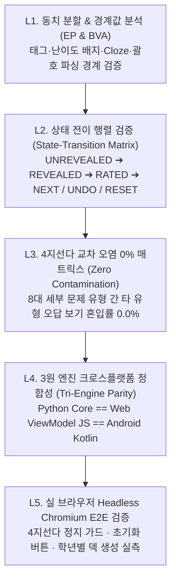

# BrainDeck 5계층 소프트웨어 테스트 방법론 및 교육부(MOE) 학년별 공식 교육과정 총람

- **문서 버전**: v5.7 (2026-10-22 확정)
- **적용 대상**: BrainDeck (브레인덱) Web / iOS PWA · Python Core Engine · Android Native App

---

## 1. 5계층 소프트웨어 테스트 방법론 (5-Layer Verification & Test Methodology)

단순히 함수 몇 개를 호출해 보는 단편적 테스트를 지양하고, **동치 분할(Equivalence Partitioning)·경계값 분석(BVA)·상태 전이 행렬(State-Transition Matrix)·교차 오염 제로 매트릭스(Zero-Contamination Matrix)·3원 엔진 정합성(Tri-Engine Parity)·실제 브라우저 E2E(Real Browser Journey)**로 구성된 **5계층 표준 테스트 방법론**을 수립하여 전수 검증합니다.

### 계층별 검증 기준 및 불변식 (Verification Invariants)

| 계층 | 테스트 기법 | 핵심 검증 대상 및 통과 기준 (Pass Criteria) |
| :--- | :--- | :--- |
| **L1** | **동치 분할 & 경계값 분석** *(Equivalence Partitioning & BVA)* | • `[Lv.1 기초]`, `[Lv.2 문맥 빈칸]`, `[Lv.3 심화·역방향]` 배지 내 영문(`Lv`)이 비영어 카드를 영단어로 오분류하지 않을 것 • 기본 폴백 태그 `role:core_vocab`이 한국사·과학·한자·국어 카드를 오염시키지 않을 것 • `{{c1::정답::힌트}}` Cloze 마커 및 `(품사)`·`💡 해설:` 분리 시 정답 스포일러가 질문에 노출되지 않을 것 |
| **L2** | **상태 전이 행렬 테스트** *(State-Transition Matrix)* | • **`UNREVEALED` ➔ (4지선다 보기 클릭) ➔ `REVEALED_WAIT_RATING`**: 보기 클릭 즉시 다음 카드로 자동 스킵(`submitRating`)하는 행위를 원천 차단하고, 반드시 정답(초록)·오답(빨강) 및 `💡 해설`을 화면에 유지한 채 사용자의 1~4 평점 클릭을 대기할 것 • **`RATED` ➔ (`↩️ 취소`) ➔ `PREV_STATE`**: 직전 카드 복습 상태를 원자적으로 복원할 것 • **`ANY_STATE` ➔ (`🔄 초기화`) ➔ `INITIAL_NEW_STATE`**: 선택된 덱(또는 전체 덱)의 모든 카드를 `state='new', reps=0, lapses=0, stability=1.2, difficulty=5.0`으로 초기화하고 1번 카드부터 즉시 재학습 가능할 것 |
| **L3** | **4지선다 교차 오염 매트릭스** *(Distractor Contamination Matrix)* | • 8대 세부 유형(`eng_vocab_meaning`, `eng_vocab_word`, `eng_grammar`, `hanja_hun_eum`, `hanja_char`, `idiom`, `ko_dictation`, `history`, `science`) 전수 조합에서 타 유형 보기가 섞이는 비율 **0.0%** • 소규모 덱(카드 1~2장)에서도 유형 전용 폴백 오답 뱅크가 작동해 항상 동종 보기 4개를 보장할 것 |
| **L4** | **3원 엔진 정합성 테스트** *(Tri-Engine Parity)* | • 동일한 카드 입력에 대해 Python(`rea_v56.py`), Web/iOS JS(`viewmodel.js`), Android Kotlin(`AdaptiveQuizEngine.kt`) 3개 엔진이 동일한 `category_key` 및 `facet_key`를 반환할 것 |
| **L5** | **실제 브라우저 E2E 테스트** *(Playwright Chromium E2E)* | • 실제 Chromium 렌더링 환경에서 4지선다 클릭 후 카드가 넘어가지 않고 정지하는지, 평점 클릭 후 이동하는지, `🔄 초기화` 버튼 클릭 시 전체 카드 수가 초기 상태로 복원되는지 실측 검증할 것 |

---

## 2. 교육부(MOE) 공식 가이드 학년별 영단어 및 전 교과 필수 학습 자료 ("알아야 할 것들")

2022 개정 교육과정(교육부 고시 제2022-33호) 기본 어휘표 및 국가 수준 성취기준을 바탕으로, 초등학교 3학년부터 고등학교(수능)까지 학년별·교과별로 반드시 알아야 할 핵심 자료를 수집·검증하여 내장했습니다.

### 2.1 학년별·교과별 내장 컬렉션 카탈로그 요약

| 컬렉션 ID | 학년 / 수준 | 교과 영역 | 수록 내용 및 교육부 기준 근거 |
| :--- | :--- | :--- | :--- |
| `moe-eng:elem-3-4` | **초등 3~4학년** (Junior) | 영어 기초 어휘 | 교육부 초등 기본 어휘 중 의사소통 입문 필수 단어 (생활·가족·학교·자연·동작 핵심 어휘) |
| `moe-eng:elementary` | **초등 5~6학년** (Junior) | 영어 필수 800 | 교육부 고시 초등 필수 영단어 800 중 고빈도 핵심 명사·동사·형용사 (도서관, 병원, 방학, 박물관, 환경 등) |
| `moe-eng:middle-1200` | **중학교 1~3학년** (Teen) | 영어 어휘·문법 | 교육부 중학 기본 어휘 1,200 핵심 단어 + 중학 내신 필수 문법(현재완료, 관계대명사, 수동태, 가정법, 사역·감각동사 등) |
| `moe-eng:high-csat` | **고등학교 1~3학년·수능** | 영어 학술 어휘 | 교육부 고교 기본·심화 어휘 1,800 및 대학수학능력시험 빈출 추상·학술 어휘 (`sustainable`, `perspective`, `hypothesis` 등) |
| `moe-kor:orthography-lit` | **초·중·고 공통** | 국어 어문규정·문학 | 한글 맞춤법(며칠/금세/어떡해/낫다·낳다)·표준어 규정 및 중·고교 필수 문학 개념어(객관적 상관물, 역설법, 반어법, 전지적 시점) |
| `moe-hanja-1800:middle` | **중·고등학교** | 한문 기초한자 1,800 | 교육부 고시 한문 교육용 기초한자 1,800자(중학 900자 + 고교 900자) 대표 훈음·부수·획수 |
| `ko-idiom:essential` | **초·중·고·성인** | 필수 사자성어 | 교과서 및 각종 시험 빈출 필수 사자성어·고사성어 (고진감래, 대기만성, 역지사지, 일석이조 등) |
| `khist:essential` | **초등 5~6·중·고교** | 한국사 필수 연표 | 고조선 건국·삼국 통일·훈민정음 창제(1443)·강화도 조약(1876)·갑신정변(1884)·3·1 운동(1919) 등 시대별 핵심 사건 |
| `sci-element-formula:core` | **중·고등학교** | 과학 법칙·원소 | 물리(옴의 법칙, 뉴턴 운동 제2법칙, 역학적 에너지)·화학(원소기호, 이온·공유결합)·생명과학(ATP, 광합성)·지구과학 핵심 개념 |
| `moe-math:core-formulas` | **중·고등학교** | 수학 필수 공식 | 피타고라스 정리($a^2+b^2=c^2$), 이차방정식 근의 공식·판별식($D=b^2-4ac$), 지수법칙, 삼각함수 제곱 관계($\sin^2\theta+\cos^2\theta=1$), 등차수열·미분계수 |

### 2.2 학년별 필수 영단어 및 교과 핵심 개념 상세 일람

#### (1) 초등 3~4학년 기초 영단어 (`moe-eng:elem-3-4`)
- **핵심 어휘**: `apple`(사과), `family`(가족), `friend`(친구), `school`(학교), `teacher`(선생님), `morning`(아침), `water`(물), `color`(색깔), `animal`(동물), `music`(음악), `happy`(행복한), `listen`(듣다), `write`(쓰다), `brother`(형·오빠·남동생), `sister`(언니·누나·여동생), `doctor`(의사), `pencil`(연필), `window`(창문), `summer`(여름), `winter`(겨울)

#### (2) 초등 5~6학년 필수 영단어 800 핵심 (`moe-eng:elementary`)
- **핵심 어휘**: `library`(도서관), `hospital`(병원), `weather`(날씨), `tomorrow`(내일), `yesterday`(어제), `breakfast`(아침 식사), `exercise`(운동; 운동하다), `vacation`(방학, 휴가), `museum`(박물관), `science`(과학), `history`(역사), `different`(다른), `important`(중요한), `favorite`(가장 좋아하는), `together`(함께), `because`(~ 때문에), `festival`(축제), `recycle`(재활용하다), `future`(미래), `protect`(보호하다)

#### (3) 중학교 1~3학년 필수 영단어 1,200 & 핵심 문법 (`moe-eng:middle-1200`)
- **핵심 어휘**: `environment`(환경), `communication`(의사소통), `opportunity`(기회), `experience`(경험), `government`(정부), `relationship`(관계), `independent`(독립적인), `responsible`(책임이 있는), `participate`(참여하다), `appreciate`(감사하다·진가를 인정하다), `volunteer`(자원봉사하다), `tradition`(전통), `creative`(창의적인), `confident`(자신감 있는), `influence`(영향), `achieve`(성취하다)
- **중학 필수 영문법 8대 체계**:
  1. **현재완료 (`have/has + p.p.`)**: 완료·경험·계속·결과 용법
  2. **관계대명사 (`who / which / that`)**: 선행사 수식 및 주격·목적격 구분
  3. **수동태 (`be + p.p. + by`)**: 행위의 대상이 주어가 되는 구문
  4. **비교급·최상급 (`-er than / the -est`)**: 원급·비교급·최상급 비교 표현
  5. **to부정사 vs 동명사 목적어**: `want/hope/plan/decide + to-V` vs `enjoy/finish/mind/avoid + V-ing`
  6. **가정법 과거 (`If + S + 과거동사(were), S + would/could + 동사원형`)**: 현재 사실의 반대 가정
  7. **사역동사 (`make / have / let + 목적어 + 동사원형`)**: 목적격 보어 원형부정사 규칙
  8. **감각동사 (`look / sound / smell / taste / feel + 형용사`)**: 부사(`-ly`) 사용 불가 규칙

#### (4) 고등학교·수능 필수 학술 어휘 (`moe-eng:high-csat`)
- **핵심 어휘**: `sustainable`(지속 가능한), `perspective`(관점·시각), `consequence`(결과·중요성), `inevitable`(불가피한), `phenomenon`(현상), `hypothesis`(가설), `simultaneously`(동시에), `acknowledge`(인정하다), `controversy`(논란), `predominant`(지배적인), `diversity`(다양성), `comprehend`(이해하다), `contribute`(기여하다), `fundamental`(근본적인), `interpret`(해석하다), `significant`(중요한·유의미한), `substitute`(대체하다), `accumulate`(축적하다)

#### (5) 국어·한문·역사·과학·수학 필수 "알아야 할 것들"
- **국어 (`moe-kor:orthography-lit`)**: 한글 맞춤법 제27항(`며칠`), 준말 규정(`금세`, `어떡해`), 동음이의어 구분(`낫다/낳다`, `되다/돼다`), 의존명사 띄어쓰기(`할 수 있다`, `아는 만큼`), 시적 허용·객관적 상관물·역설법·반어법·서술자 시점.
- **한문 (`moe-hanja-1800:middle`)**: 교육부 한문 교육용 기초한자 1,800자 중 핵심 자형·훈음·부수 및 교과서 사자성어.
- **한국사 (`khist:essential`)**: 고조선 8조법, 삼국 시대 전성기 왕(근초고왕·광개토대왕·진흥왕), 발해 건국(698), 고려 금속활자 직지심체요절(1377), 조선 훈민정음(1443)·경국대전, 강화도 조약(1876)·갑신정변(1884)·동학 농민 운동(1894)·독립협회(1896)·3·1 운동 및 대한민국 임시정부(1919).
- **과학 (`sci-element-formula:core`)**: 옴의 법칙($V=IR$), 뉴턴 운동 제2법칙($F=ma$), 역학적 에너지 보존, 미토콘드리아 세포 호흡(ATP), 엽록체 광합성, 공유결합·이온결합, 산·염기 중화반응($\text{H}^+ + \text{OH}^- \rightarrow \text{H}_2\text{O}$), 판 구조론.
- **수학 (`moe-math:core-formulas`)**: 피타고라스 정리($a^2+b^2=c^2$), 이차방정식 근의 공식($x=\frac{-b\pm\sqrt{b^2-4ac}}{2a}$) 및 판별식($D=b^2-4ac$), 지수법칙, 삼각함수 제곱 관계($\sin^2\theta+\cos^2\theta=1$), 등차수열 일반항($a_n=a+(n-1)d$), 순간변화율·미분계수($f'(a)$).
