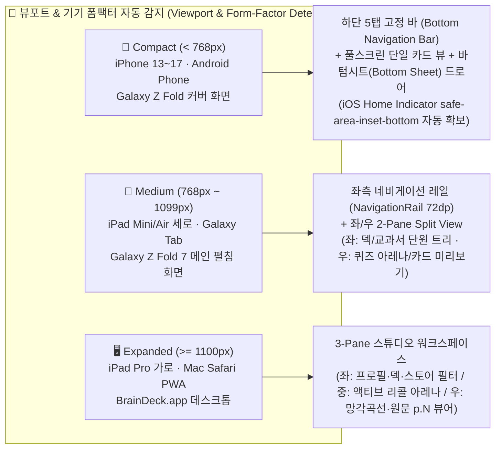
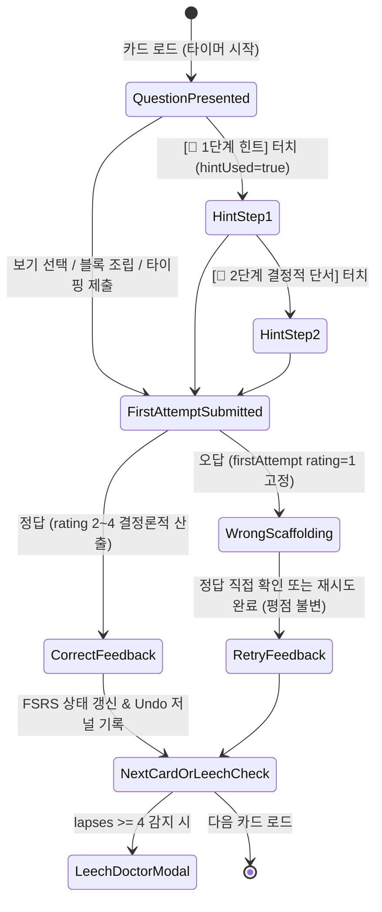

# 🎨 BrainDeck (브레인덱) — 전 연령(초등~성인) & 크로스플랫폼(Apple PWA · Android) UI/UX 마스터 설계도 (`v4.0 Final`)

- **문서 번호**: `BRAINDECK-UIUX-2026-10-21` (**v4.0 Final — Age-Adaptive & Offline-First Cross-Platform UI/UX Blueprint**)
- **연계 아키텍처 정본**: [`docs/ARCHITECTURE_AND_FEATURE_BLUEPRINT.md`](./ARCHITECTURE_AND_FEATURE_BLUEPRINT.md) (`T1 ~ T34` 34대 아키텍처 함정 방어 연동)
- **구현 대상 계층**:
  - **Apple (iPhone · iPad · Mac) Standalone Web-App (PWA)**: `src/braindeck/ui/static/index.html`, `viewmodel.js`, `app.js`, `manifest.json`
  - **Android 네이티브 앱 (Phone · Tablet · Galaxy Z Fold)**: `android-app/app/src/main/java/com/braindeck/app/ui/BrainDeckViewModel.kt`, `MainActivity.kt`

---

## 1. 핵심 UX 철학 (3대 디자인 원칙)

1. **Zero-Friction 3-Second Entry (앱 실행 후 3초 내 학습 진입)**:
   - 기존 플래시카드의 복잡한 설정 메뉴·덱 트리·동기화 팝업을 첫 화면에서 제거한다.
   - 앱을 열면 **"오늘 복습할 카드 N장"**과 **`[🎯 지금 복습 시작]`** 원터치 히어로 버튼이 가장 먼저 보이며, 타이핑이 어려운 초등학생부터 출퇴근길 성인까지 1번의 터치로 즉시 복습 아레나에 진입한다.
2. **Age-Adaptive Progressive Scaffolding (연령별 눈높이 자동 변신 UI)**:
   - 동일한 앱 코어 위에서 상단 프로필 배지(`🌱 초등 Junior` / `🚀 중고등 Teen` / `🎓 성인 Adult`)를 전환하면 **글자 크기, 최소 터치 영역, 카드 글자 수 밀도, 기본 퀴즈 모드(4지선다 ➔ 글자블록 ➔ 서술형 인출), 보상 피드백**이 즉시 연령에 맞게 재구성된다.
3. **100% Self-Contained Vault Experience (인터넷 없이도 내 앱 안에서 완결되는 체감)**:
   - 웹페이지처럼 매번 로딩되거나 외부 링크로 튕기지 않는다.
   - 상단 상태바의 **`🟢 내 기기 금고 안전 보관 중 (오프라인 작동)`** 인디케이터를 통해 내가 직접 찍어 올린 프린트물과 스토어에서 구매(`₩990~₩1,900`)해 장착한 브레인팩이 내 폰/아이패드 안에 영구 내장되어 있음을 시각적으로 확신시킨다.

---

## 2. 플랫폼별 반응형 레이아웃 아키텍처 (Apple PWA & Android Adaptive Layout)



### 2.1 Apple (iPhone / iPad / Mac) 사파리 웹앱(PWA) 전용 UX 가드레일 (`T29, T30, T32` 연동)
- **Standalone 풀스크린 설치 유도 배너 (`Install-to-Home-Screen Coachmark`)**:
  - iOS/iPadOS 일반 사파리 탭(`window.navigator.standalone === false`)에서 접속 시, 하단 공유 버튼(`⬆️`) 위치를 가리키는 비침투형 플로팅 배너 **`"📲 [공유 ⬆️] → [홈 화면에 추가]를 누르면 주소창 없는 진짜 앱으로 영구 보관됩니다"`**를 표시한다.
- **노치 / 다이나믹 아일랜드 / 홈 인디케이터 Safe-Area 보장**:
  - 상단 헤더 `padding-top: max(12px, env(safe-area-inset-top))` 및 하단 탭바 `padding-bottom: max(16px, env(safe-area-inset-bottom))`를 강제하여 아이폰 노치와 하단 스와이프 바와 절대 겹치지 않는다.
- **첫 터치 오디오/TTS 세션 자동 언락 (`T32`)**:
  - `[복습 시작]` 또는 `[🔊 발음 듣기]` 첫 터치 시 WebKit `speechSynthesis` 및 `AudioContext` 세션을 즉시 언락하여 받아쓰기·어학 발음이 끊김 없이 재생되도록 보장한다.

### 2.2 Android (스마트폰 / 태블릿 / 갤럭시 Z 폴드) 전용 UX 가드레일 (`T33` 연동)
- **Material 3 Adaptive Navigation**:
  - 일반 스마트폰(`Compact`): 하단 엄지 영역(`Thumb Zone`)에 최적화된 4~5탭 `NavigationBar`.
  - 태블릿 및 폴드 펼침(`Medium/Expanded`): 좌측 `NavigationRail` + 우측 2-Pane 분할 레이아웃(왼쪽에서 교과서 단원/쪽수를 체크하면 오른쪽에서 해당 범위 카드가 실시간 미리보기로 갱신).
- **시스템 공유 시트(`ACTION_SEND` / `ACTION_SEND_MULTIPLE`) 직결**:
  - 갤러리나 파일 앱에서 시험지 사진·PDF를 선택해 `BrainDeck으로 공유`를 누르면 앱이 열림과 동시에 **`[📸 스캔 & 카드 검수 시트]`**로 직행한다.

---

## 3. 연령별 3-Tier 디자인 토큰 매트릭스 (`resolveUiUxTokens`)

| 디자인 토큰 항목 | 🌱 **초등 모드 (`Junior` · 8~13세)** | 🚀 **중고등 모드 (`Teen` · 14~19세)** | 🎓 **성인/프로 모드 (`Adult` · 20세+)** |
| :--- | :--- | :--- | :--- |
| **시각 테마 & 분위기** | **Warm Daylight / Soft Indigo**<br>친근한 둥근 카드(`radius: 20px`), 큰 아이콘, 별(⭐)/스트릭(🔥) 칭찬 배지 강조 | **Focused Exam Dark / Cobalt**<br>선명한 교실·수험 대시보드(`radius: 14px`), 내신 D-Day 배지 및 단원 진도율 바 강조 | **Zen Glassmorphism Dark**<br>몰입형 다크 스튜디오(`radius: 12px`), 고밀도 정보 표시, 키보드 단축키 힌트 표시 |
| **본문 / 카드 질문 폰트 크기** | 질문 **`22px (1.375rem)`** · 보기 **`18px`**<br>줄간격 `1.65` (초등 저학년 가독성 최적화) | 질문 **`19px (1.1875rem)`** · 보기 **`16px`**<br>줄간격 `1.55` | 질문 **`17px (1.0625rem)`** · 본문 **`15px`**<br>줄간격 `1.50` (조문·수식·코드 고정폭 지원) |
| **최소 터치 타겟 높이 (`minTouchTargetPx`)** | **`56px`** (손가락 조작이 서툰 초등학생 오터치 원천 방지) | **`48px`** (모바일 한 손 엄지 조작 표준) | **`44px`** (Apple HIG & Material 최소 규격) |
| **한 화면 최대 텍스트 노출량** | 앞면 **40자** / 뒷면 **60자** 이내 | 앞면 **100자** / 뒷면 **150자** 이내 | 앞면 **220자** / 뒷면 **400자** 이내 |
| **기본 출제 인터랙션 (`quiz_stage` 초기값)** | **Stage 0 (`4지선다 객관식`)** 또는 **`오프라인 TTS 받아쓰기`** 우선<br>*(자기평가 `Easy(4)` 버튼 숨김)* | **Stage 0 (`4지선다`) ➔ Stage 1 (`단어블록`) ➔ Stage 2 (`빈칸/서술형`)** 자동 승격 | **Stage 2 (`직접 타이핑 / 음성 인출 / 4버튼`)** 우선 |
| **오답 시 UX 피드백** | 빨간색 경고 대신 **부드러운 앰버색(`#F59E0B`) + `"거의 다 왔어요! 힌트 요정을 볼까요?"`** | 정답 핵심 키워드 하이라이트 + **교과서 단원/쪽수(`Lesson 2 · p.31`) 출처 표시** | 의미 유사도 점수(`0~100%`), 누락 수치/조문 토큰 비교 Diff, **Leech 거머리 카드 분할 제안** |

---

## 4. 5대 핵심 화면 상세 와이어프레임 & 인터랙션 규격

### 4.1 [탭 1] 🏠 홈 & 오늘의 브레인 대시보드 (`Home / Today Hub`)

```text
+-------------------------------------------------------------------+
| 🧠 BrainDeck (브레인덱)     [🌱초등 | 🚀중고등* | 🎓성인]  🟢오프라인금고 |
+-------------------------------------------------------------------+
|  🔥 연속 12일 학습 중!        🎯 중간고사(영어·역사) D-14             |
|  +-------------------------------------------------------------+  |
|  |  오늘 복습할 카드: 28장 (신규 15장 · 복습 13장)                |  |
|  |  예상 소요 시간: 약 6분 · 목표 기억률 90%                      |  |
|  |  [ 🚀 지금 오늘의 복습 시작하기 (Space / 원터치) ]             |  |
|  +-------------------------------------------------------------+  |
|                                                                   |
|  📂 내 시험범위 & 활성 브레인덱                                    |
|  +-----------------------------+ +-----------------------------+  |
|  | 📘 중1 동아(윤) 영어 1~3단원 | | 📜 어문회 한자 7급~5급 마스터|  |
|  | 오늘 16장 · 기억률 92%       | | 오늘 12장 · 기억률 88%       |  |
|  | [복습하기] [시험범위 수정]   | | [복습하기] [단원 추가]       |  |
|  +-----------------------------+ +-----------------------------+  |
|                                                                   |
|  ⚡ 빠른 시작 바로가기                                             |
|  [ 📸 내 프린트·교재 사진 찍어 무료 카드 만들기 ] [ 🏪 브레인팩 스토어 (₩990~) ] |
+-------------------------------------------------------------------+
|  🏠 홈     🎯 복습아레나    📸 스캔·시험범위    🏪 스토어(₩990~)    📊 보관함  |
+-------------------------------------------------------------------+
```

---

### 4.2 [탭 2] 🎯 액티브 리콜 아레나 (`Active Recall Arena — Zen Study View`)

카드별 `quiz_stage (0 ➔ 1 ➔ 2)`와 학습 분야(`pattern`)에 따라 화면 하단 인터랙션 독(Dock)이 자동으로 전환된다.



- **모드 A — `Stage 0: 4지선다 객관식 (Multiple Choice)`**:
  - `DistractorSelector`가 생성한 스포일러 없는 4개 보기 버튼을 `56px(초등)/48px(중고등)` 높이의 큼직한 카드형 버튼으로 배치.
  - 첫 번째 터치(`attempt_count = 1`)에서 즉시 정오답 판정 및 `gradeInteraction` 평점(`Good 3` 상한) 반영.
- **모드 B — `Stage 1: 글자/단어 블록 터치 조립 (Tap Block)`**:
  - 정답을 구성하는 음절/단어 칩과 교란 칩 2~3개를 섞어 제시하고, 터치 순서대로 상단 슬롯에 조립(`blockCorrections` 취소 횟수 자동 계측).
- **모드 C — `Stage 2: 받아쓰기(Dictation) & 서술형 능동 인출(Free Recall)`**:
  - `[🔊 원어민/선생님 발음 다시 듣기]` 버튼 + 텍스트/음성 입력창.
  - 제출 시 한글 자모 편집거리(`jamoEditDistance`) 또는 의미 토큰·수치 일치율을 채점하여 **누락된 핵심 키워드는 초록색 하이라이트, 틀린 수치는 주황색 비교 배지**로 즉시 피드백.
- **상단 보조 액션 바**:
  - `↩️ 실행 취소 (Undo)`: 직전 카드(또는 연결된 Cloze 그룹) 평가를 100% 원상 복구.
  - `📄 출처 p.N 보기`: 해당 카드가 추출된 원본 시험지/PDF의 물리 페이지 WebP 스냅샷과 바운딩 박스를 모달로 표시.
  - `🧬 거머리 카드 자동 쪼개기 (Leech Doctor)`: 4회 이상 틀린 복합 카드를 2~3장의 쉬운 단일 개념 카드로 분할 미리보기 후 원터치 저장(원본 카드는 자동 일시중지 `suspended = 1`).

---

### 4.3 [탭 3] 📸 3초 AI 스캔 & 중·고등 교과서 시험범위 빌더 (`Ingest & Exam-Scope Slicer`)

두 가지 카드 생성 경로를 상단 세그먼트 탭으로 명확히 분리한다:

1. **`[📸 내 자료 직접 올려 무료 생성 (₩0)]` (Self-Upload Free Flow)**:
   - **Step 1 (투입)**: 카메라 연속 촬영(`multiple`, `capture="environment"`) 또는 PDF/이미지 드롭존 (`20MB` / `50p` 가드, `T33` 장변 `2048px` 자동 리사이즈).
   - **Step 2 (AI 무환각 추출 & 품질 배너)**:
     - 상단에 `🟢 원문 100% 근거 검증 완료 (환각 의심 0장 자동 폐기)` 배너 표시.
     - 만약 암호화/손상 PDF이거나 텍스트가 40자 미만이면 `🔴 Fail-Closed 차단 배너`를 띄우고 저장 버튼을 비활성화(`canSave = false`).
   - **Step 3 (인라인 검수 & 1-Click 덱 저장)**:
     - 생성된 카드 목록에서 앞/뒷면을 즉시 수정하거나 불필요한 카드를 개별 삭제(`[삭제]`)한 뒤 `[✅ N장 덱으로 내 기기에 저장]` 실행.
2. **`[🏫 중·고등 교과서 시험범위 슬라이서]` (School Exam-Scope Builder)**:
   - **Step 1**: 학교급(`중학교 / 고등학교`) ➔ 과목(`영어 / 역사 / 과학 / 국어`) ➔ 출판사(`동아 윤정미 / 미래엔 / 비상` 등) 선택.
   - **Step 2**: 대단원/중단원 체크박스 트리(`Lesson 1`, `Lesson 2`...) + **쪽수 슬라이더(`p.12 ~ p.38`)** + 중요도 필터(`핵심 필수만` vs `단원 전체`) + `[☑️ 내가 찍은 학교 프린트물 카드 자동 합치기]` 토글.
   - **Step 3**: 시험 D-Day 날짜 입력 시 **"시험 3일 전까지 완주하려면 하루 N장씩 학습하면 됩니다"** 안내와 함께 전용 시험범위 덱 즉시 생성.

---

### 4.4 [탭 4] 🏪 인앱 브레인팩 스토어 (`BrainPack Store — ₩0 무료 + ₩990~₩1,900 초소액 마켓`)

```text
+-------------------------------------------------------------------+
| 🏪 브레인팩 스토어 (BrainPack Store)       보유: 2 / 9팩 장착 완료 |
| "내 프린트·사진 업로드는 평생 ₩0 무료! 검증된 마스터팩은 공책 한 권 값(₩990~)"|
+-------------------------------------------------------------------+
| 필터: [전체(9)] [🎁무료기본] [🏫중고등교과서(₩990)] [📜한자·한국사(₩1,500)] [✈️어학·자격증(₩1,900)] |
| 연령: [전체 연령] [🌱초등 Junior] [🚀중고등 Teen] [🎓성인 Adult]   |
+-------------------------------------------------------------------+
| 💡 [학기 내신 골라담기 번들 혜택] 3팩 이상 동시 선택 시 15% 자동 할인! |
+-------------------------------------------------------------------+
| +-------------------------------+ +-----------------------------+ |
| | 🎁 [무료 기본 탑재]            | | 🔥 중1 내신 베스트           | |
| | 초등 받아쓰기·영단어·한자 8급  | | [중1 내신] 동아(윤정미) 영어 | |
| | 가격: 무료 (₩0)               | | 가격: ₩990 (전 단원·쪽수 완비)| |
| | • 8급 한자 + 받아쓰기 + 영단어 | | • Lesson 1~8 어휘·문법 매핑  | |
| | • 샘플: [韓 -> 나라 한]        | | • 샘플: [introduce -> 소개하다]| |
| | [ ✅ 내 앱에 기본 장착 완료 ]  | | [ ⚡ ₩990 원터치 구매·즉시장착 ]| |
| +-------------------------------+ +-----------------------------+ |
+-------------------------------------------------------------------+
```

- **스토어 핵심 UX 불변식**:
  1. **구매 전 샘플 카드 미리보기**: 모든 브레인팩 카드에는 실제 수록된 대표 샘플 카드 2~3장이 표시되어 품질을 먼저 확인한 뒤 구매할 수 있다.
  2. **구매 즉시 온디바이스 영구 장착 (`1-Tap Buy & Mount`)**: 결제 검증 완료와 동시에 별도 파일 다운로드 창이나 압축 해제 과정 없이 **즉시 내 앱의 덱 목록과 오프라인 금고(`BrainDeckLocalVault` & SQLite `store_entitlements`)에 영구 장착**되며, 버튼이 `✅ 앱 내 장착 완료 (바로 복습하기)`로 바뀐다.
  3. **재구매/중복 클릭 완벽 방어 (`Idempotent Mount`)**: 이미 구매한 팩을 다시 누르면 추가 과금이나 중복 카드 생성 없이 곧바로 해당 덱 복습 화면으로 안내한다.
  4. **3팩 이상 골라담기 번들 할인 (`T34` 연동)**: 여러 과목 교과서 팩(`₩990`)을 한꺼번에 담으면 **3팩 이상 15% 할인(예: 교과서 3팩 `₩2,970 ➔ ₩2,500`)**이 자동 계산되어 반복 결제 피로도를 없앤다.

---

### 4.5 [탭 5] 📊 기억 분석 & 오프라인 금고 / 가족 프로필 (`Analytics & Offline Vault`)

- **실측 기반 기억 지표 (`Zero Fabricated Status`)**:
  - FSRS-5 망각곡선 $R(t, S) = (1 + \frac{19}{81}\frac{t}{S})^{-0.5}$ 실시간 SVG 그래프.
  - **재인(`Recognition` · 객관식 통과) vs 완전 회상(`Recall` · 백지/받아쓰기 인출 성공)** 2단계 마스터리 게이지 분리 표시 (`T16` 방어: 객관식만 맞힌 카드를 완전 암기로 과장하지 않음).
- **오프라인 금고 상태 & 원터치 백업**:
  - 현재 기기 내 저장된 총 카드 수, 장착된 브레인팩 수, 마지막 오프라인 스냅샷 시각 표시.
  - `[💾 오프라인 금고 지금 동기화]` 및 `[📦 .apkg 호환 덱 내보내기 / 가져오기]` 제공.
- **가족 멀티 프로필 & 초등 안전 잠금 (`T19` 연동)**:
  - 한 대의 아이패드나 탭에서 첫째(중2 `Teen`)와 둘째(초3 `Junior`) 프로필을 1초 만에 전환하며, `Junior` 프로필 활성 시 `🔒 아동 개인정보 보호 하드락 켜짐 (외부 클라우드 전송 0건 · 시험지 이름 자동 마스킹)` 배지를 상시 표시한다.

---

## 5. 접근성(Accessibility) & 키보드/제스처 내비게이션 규격

1. **시각 접근성 (WCAG 2.1 AA 이상)**:
   - 모든 본문 텍스트 명도 대비 `4.5:1` 이상, 주요 배지 및 버튼 `7.0:1` 이상 보장.
   - 색상만으로 정오답을 구분하지 않고 아이콘(`✅ 정답` / `💡 다시 확인`)과 텍스트 라벨을 항상 병기한다.
2. **키보드 & 하드웨어 단축키 (Mac / iPad Magic Keyboard / Android 키보드)**:
   - `Space` / `Enter`: 정답 확인 또는 기본 추천 등급 제출
   - `1 / 2 / 3 / 4`: `Again(1) / Hard(2) / Good(3) / Easy(4)` 즉시 평가 (`Junior` 모드에서는 `4` 비활성화)
   - `H`: 소크라테스 힌트 열기 · `T`: 원어민 TTS 발음 재생 · `Z`: 직전 평가 실행 취소(Undo)
3. **모바일 한 손 제스처**:
   - 모든 핵심 학습 버튼(보기 선택, 정답 확인, 1~4 평가 버튼, 힌트)은 화면 하단 45%(`Thumb Zone`) 이내에 배치하여 스마트폰 한 손 파지 상태에서 엄지손가락만으로 전체 복습을 끝낼 수 있도록 설계한다.
